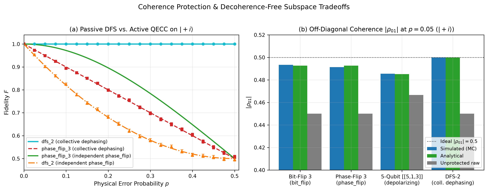
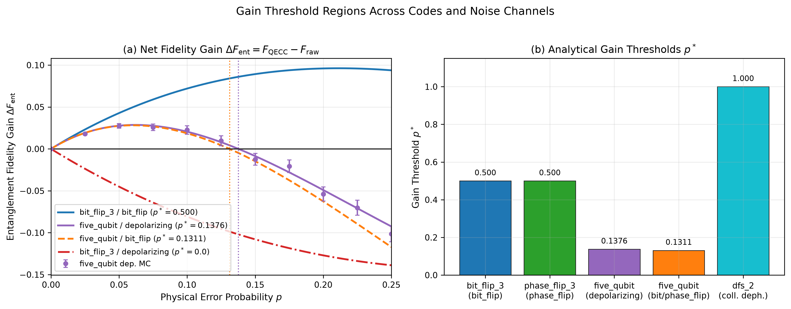
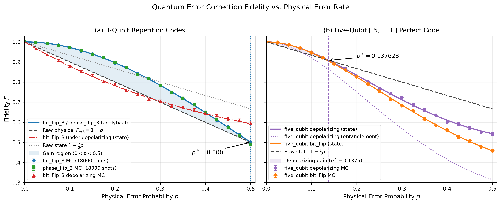

# Códigos de Correção de Erros Quânticos: Teoria, Circuitos Estabilizadores, Subespaços Livres de Decoerência e Análise de Limiar de Ganho Acelerada por GPU

**Resumo.** A informação quântica promete acelerações exponenciais para simulação, criptografia e primitivas de álgebra linear; contudo, qubits físicos sofrem continuamente com amortecimento de amplitude, defasagem e imperfeições de controle que destroem superposições coerentes em escalas de tempo de microssegundos. Diferentemente dos bits clássicos, estados quânticos desconhecidos não podem ser clonados, estão sujeitos a uma variedade contínua de erros em $SU(2)$ e colapsam irreversivelmente sob medição projetiva direta. Este manuscrito de seminário apresenta um tratamento autocontido, em nível de pós-graduação, de Códigos de Correção de Erros Quânticos (QECC), unificando a teoria analítica com verificação numérica reprodutível em uma suíte de simulação em GPU NVIDIA RTX 5080 (`sm_120`). Demonstramos o Teorema da Não-Clonagem de Wootters–Zurek, derivamos a discretização de erros via expansão na base de Pauli e as condições formais de Knill–Laflamme, construímos os códigos de 3 qubits de inversão de bit (bit-flip) e de inversão de fase (phase-flip), sintetizamos o código perfeito `[[5,1,3]]` de Laflamme que satura o limite quântico de Hamming (incluindo seus geradores estabilizadores exatos, a tabela de consulta das 16 síndromes e o enumerador de pesos de 1024 termos) e contrastamos a recuperação ativa por códigos estabilizadores com subespaços livres de decoerência (DFS) passivos de dois qubits. Analisamos a extração não destrutiva de síndrome por ancilla e a realimentação clássica (feed-forward) condicional, revisamos marcos recentes em hardware (Google Willow, processadores lógicos de átomos neutros de Harvard/Lukin, códigos qLDPC *bivariate bicycle* da IBM e qubits gato bosônicos) e derivamos os limiares analíticos de ganho exatos ($p^*$), separando estritamente a fidelidade de emaranhamento ($1 - p$) da fidelidade média de estado (média de Haar, $1 - \frac{2}{3}p$) para eliminar falácias na comparação de métricas. Cada afirmação teórica é verificada de forma cruzada em nosso simulador de código aberto em Python/CUDA (`numpy`, `torch_cuda` e `eigenkit_unitary`).

---

## Sumário

1. [Desafios Fundamentais da Correção de Erros Quânticos vs. Correção de Erros Clássica](#1-desafios-fundamentais-da-correção-de-erros-quânticos-vs-correção-de-erros-clássica)
2. [Discretização de Erros e as Condições de Knill-Laflamme](#2-discretização-de-erros-e-as-condições-de-knill-laflamme)
3. [Códigos Estabilizadores, Limite Quântico de Hamming, Proteção de Coerência e Subespaços Livres de Decoerência](#3-códigos-estabilizadores-limite-quântico-de-hamming-proteção-de-coerência-e-subespaços-livres-de-decoerência)
4. [Extração Não Destrutiva de Síndrome por Ancilla e Realimentação Clássica (Feed-Forward)](#4-extração-não-destrutiva-de-síndrome-por-ancilla-e-realimentação-clássica-feed-forward)
5. [Desenvolvimentos Recentes em Correção de Erros Quânticos](#5-desenvolvimentos-recentes-em-correção-de-erros-quânticos)
6. [Limiares Analíticos de Ganho, Consistência de Métricas e Resultados Empíricos de Simulação](#6-limiares-analíticos-de-ganho-consistência-de-métricas-e-resultados-empíricos-de-simulação)
7. [Conclusão e Resumo de Reprodutibilidade](#7-conclusão-e-resumo-de-reprodutibilidade)

---

## 1. Desafios Fundamentais da Correção de Erros Quânticos vs. Correção de Erros Clássica

A correção de erros clássica (ECC) baseia-se em três operações fundamentais que parecem quase triviais na eletrônica digital: (i) copiar um bit $b \in \{0, 1\}$ em registradores físicos redundantes $b \mapsto (b, b, b)$ antes da transmissão, (ii) tratar o ruído do canal como um conjunto discreto de eventos de inversão de bit $b \mapsto b \oplus e$ sobre $\mathbb{F}_2$, e (iii) ler diretamente cada bit físico no receptor para computar verificações de paridade e aplicar votação majoritária. Cada um desses três pilares clássicos falha na mecânica quântica.

### 1.1 O Teorema da Não-Clonagem

Na codificação clássica por repetição, a redundância é criada replicando (*fan-out*) um estado desconhecido $b$ em múltiplas cópias idênticas. Na mecânica quântica, a linearidade e a unitariedade proíbem estritamente a existência de uma máquina clonadora de estados arbitrários.

**Teorema (Teorema da Não-Clonagem de Wootters–Zurek–Dieks).** *Não existe operador unitário $U$ atuando em $\mathcal{H}_A \otimes \mathcal{H}_B$ (com $\dim \mathcal{H}_A = \dim \mathcal{H}_B \ge 2$) e estado auxiliar fixo $|0\rangle_B$ tal que $U(|\psi\rangle_A \otimes |0\rangle_B) = |\psi\rangle_A \otimes |\psi\rangle_B$ para todos os estados normalizados $|\psi\rangle \in \mathcal{H}_A$.*

**Demonstração (Linearidade e Preservação do Produto Interno).** Suponha que exista tal clonador unitário $U$, e sejam $|\psi\rangle, |\phi\rangle \in \mathcal{H}_A$ dois estados normalizados arbitrários. Por hipótese,
$$U(|\psi\rangle \otimes |0\rangle) = |\psi\rangle \otimes |\psi\rangle, \qquad U(|\phi\rangle \otimes |0\rangle) = |\phi\rangle \otimes |\phi\rangle.$$
Como $U$ é unitário, ele preserva o produto interno do espaço de Hilbert ($U^\dagger U = I$):
$$\langle \psi | \phi \rangle = (\langle \psi | \otimes \langle 0 |)(|\phi\rangle \otimes |0\rangle) = (\langle \psi | \otimes \langle 0 |) U^\dagger U (|\phi\rangle \otimes |0\rangle) = (\langle \psi | \otimes \langle \psi |)(|\phi\rangle \otimes |\phi\rangle) = \langle \psi | \phi \rangle^2.$$
A equação escalar $z = z^2$ para $z = \langle \psi | \phi \rangle \in \mathbb{C}$ possui apenas duas soluções: $z = 0$ (estados ortogonais) ou $z = 1$ (estados idênticos a menos de fase global). Equivalentemente, por linearidade, clonar $|\psi\rangle = \alpha|0\rangle + \beta|1\rangle$ produz $\alpha|00\rangle + \beta|11\rangle$ em vez do produto tensorial $(\alpha|0\rangle + \beta|1\rangle)^{\otimes 2} = \alpha^2|00\rangle + \alpha\beta(|01\rangle + |10\rangle) + \beta^2|11\rangle$ sempre que $\alpha\beta \neq 0$. Assim, códigos quânticos não podem duplicar estados desconhecidos; em vez disso, devem *emaranhar* a informação lógica ao longo de um subespaço de múltiplos qubits:
$$\alpha|0\rangle + \beta|1\rangle \;\longmapsto\; \alpha|0_L\rangle + \beta|1_L\rangle.$$

### 1.2 Espaço Contínuo de Erros ($SU(2)$ e a Esfera de Bloch)

Um bit clássico sofre apenas inversão discreta ($0 \leftrightarrow 1$). Em contraste, o estado de um único qubit $|\psi\rangle = \alpha|0\rangle + \beta|1\rangle$ (com $|\alpha|^2 + |\beta|^2 = 1$) reside na esfera de Bloch $\mathbb{CP}^1 \cong S^2$, e o ruído unitário atua no grupo de Lie contínuo $SU(2)$:
$$U(\theta, \hat{n}) = \exp\!\left(-i \frac{\theta}{2} \hat{n}\cdot\vec{\sigma}\right) = \cos\!\left(\frac{\theta}{2}\right) I - i \sin\!\left(\frac{\theta}{2}\right)(n_x X + n_y Y + n_z Z),$$
em que $\theta \in [0, 4\pi)$ e $\hat{n} \in S^2$ são parâmetros reais contínuos. De modo ainda mais geral, interações de sistemas abertos com um ambiente $\mathcal{H}_E$ evoluem o estado conjunto unitariamente e induzem um canal quântico completamente positivo e preservador de traço (CPTP) $\mathcal{E}(\rho) = \sum_k E_k \rho E_k^\dagger$, com operadores de Kraus contínuos $E_k \in \mathbb{C}^{2 \times 2}$ satisfazendo $\sum_k E_k^\dagger E_k = I$. Tanto erros de inversão de bit (bit-flip, rotações do tipo $X$) quanto erros de inversão de fase (phase-flip, defasagem do tipo $Z$ da fase relativa $\arg(\alpha^*\beta)$), bem como sobre-rotações coerentes infinitesimais $\theta \ll 1$, acumulam-se continuamente. Sem discretização ativa, um decodificador não pode simplesmente medir um ângulo analógico $\theta$ com precisão finita e subtraí-lo.

### 1.3 Colapso Projetivo sob Medição Direta

Decodificadores clássicos leem cada fio físico $y_i \in \{0, 1\}$ diretamente e computam verificações de paridade $H y \pmod 2$. Se tentarmos medir um qubit físico de dados de um estado codificado $|\psi_L\rangle = \alpha|000\rangle + \beta|111\rangle$ na base computacional $\{|0\rangle, |1\rangle\}$, a regra projetiva de Born fornece o resultado $0$ com probabilidade $|\alpha|^2$ (colapsando o estado para $|000\rangle$) e o resultado $1$ com probabilidade $|\beta|^2$ (colapsando o estado para $|111\rangle$). Em ambos os ramos, a coerência fora da diagonal $\rho_{01} = \alpha\beta^*$ é completamente apagada! A correção de erros quânticos deve, portanto, extrair *apenas* informação sobre *qual erro ocorreu*, enquanto aprende *zero* informação sobre as amplitudes lógicas $\alpha$ e $\beta$.

| Dimensão | ECC Clássica | Códigos de Correção de Erros Quânticos (QECC) |
|---|---|---|
| **Mecanismo de redundância** | Clonagem por *fan-out* $b \mapsto (b, b, \dots, b)$ | Subespaço de código emaranhado $\alpha\vert 0_L\rangle + \beta\vert 1_L\rangle$ (o Teorema da Não-Clonagem proíbe $\vert\psi\rangle^{\otimes n}$) |
| **Variedade de erros** | Inversões de bit discretas sobre $\mathbb{F}_2^n$ | Grupo contínuo $SU(2)^{\otimes n}$ / mapas de Kraus CPTP (inversão de bit, inversão de fase, rotações coerentes) |
| **Leitura de síndrome** | Leitura direta de bits seguida de XOR de paridade | Extração não destrutiva de síndrome por ancilla dos geradores estabilizadores $S_k$ |
| **Modo de falha da medição direta** | Nenhum (a leitura é não destrutiva) | Colapso projetivo destrói a superposição e a coerência fora da diagonal $\rho_{01}$ |

---

## 2. Discretização de Erros e as Condições de Knill-Laflamme

### 2.1 Expansão na Base de Pauli

As matrizes de Pauli de um único qubit $\{I, X, Y, Z\}$ formam uma base ortonormal (sob o produto interno de Hilbert–Schmidt $\frac{1}{2}\operatorname{Tr}(P^\dagger Q) = \delta_{PQ}$) para o espaço $\mathbb{C}^{2 \times 2}$ de todos os operadores lineares de um qubit:
$$I = \begin{pmatrix} 1 & 0 \\ 0 & 1 \end{pmatrix}, \quad X = \begin{pmatrix} 0 & 1 \\ 1 & 0 \end{pmatrix}, \quad Y = \begin{pmatrix} 0 & -i \\ i & 0 \end{pmatrix}, \quad Z = \begin{pmatrix} 1 & 0 \\ 0 & -1 \end{pmatrix}.$$
Consequentemente, **qualquer** operador de Kraus de um único qubit $E_k$ pode ser escrito como uma combinação linear complexa
$$E_k = c_{k,I} I + c_{k,X} X + c_{k,Y} Y + c_{k,Z} Z, \qquad c_{k,P} = \frac{1}{2}\operatorname{Tr}(P E_k).$$
Em um registrador de $n$ qubits, as $4^n$ cadeias de Pauli em produto tensorial $P \in \{I, X, Y, Z\}^{\otimes n}$ formam uma base completa de operadores para $\mathbb{C}^{2^n \times 2^n}$. Qualquer operador de Kraus de $n$ qubits $E_k$ atuando no máximo em $t$ qubits decompõe-se como $E_k = \sum_{\operatorname{wt}(P) \le t} c_{k,P} P$.

### 2.2 Discretização Projetiva via Medição de Síndrome

Suponha que um código $\mathcal{C} \subset (\mathbb{C}^2)^{\otimes n}$ seja protegido por um conjunto comutativo de verificações estabilizadoras de Pauli $\{S_1, \dots, S_r\}$ tal que todo erro de Pauli corrigível $P \in \mathcal{E}_{\text{Pauli}}$ produza uma cadeia de bits de síndrome única $s(P) \in \{0, 1\}^r$ (ou recaia em uma coclasse degenerada $P S$ com recuperação idêntica). Quando um erro contínuo de um único qubit $E_k = \sum_{P \in \{I,X,Y,Z\}} c_{k,P} P$ atua sobre o qubit $q$ de um estado codificado arbitrário $|\psi_L\rangle \in \mathcal{C}$, o estado corrompido é uma *superposição coerente* de ramos afetados por operadores de Pauli:
$$E_k^{(q)} |\psi_L\rangle = \sum_{P \in \{I, X, Y, Z\}} c_{k,P}\, P^{(q)} |\psi_L\rangle.$$
Crucialmente, ao executarmos a medição projetiva de síndrome dos estabilizadores em qubits ancilla, a medição projeta a superposição contínua sobre um *único* subespaço de síndrome $\Pi_s$ com probabilidade $p_s = \| \Pi_s E_k^{(q)} |\psi_L\rangle \|^2$:
$$\Pi_s E_k^{(q)} |\psi_L\rangle = c_{k,P_s}\, P_s^{(q)} |\psi_L\rangle.$$
A menos de um fator escalar de normalização, o erro contínuo $E_k$ *colapsou* em um erro de Pauli discreto e exato $P_s^{(q)}$! Aplicar a recuperação unitária discreta $R_s = P_s^{(q)\dagger} = P_s^{(q)}$ restaura $|\psi_L\rangle$ com fidelidade unitária. Em outras palavras, **medir a síndrome de erro digitaliza erros quânticos contínuos em erros de Pauli discretos**.

### 2.3 Condições Formais Necessárias e Suficientes de Knill-Laflamme

Quais códigos $\mathcal{C}$ e conjuntos de erros $\mathcal{E} = \{E_a\}$ admitem correção exata de erros? Essa questão é respondida integralmente pelo teorema de Knill–Laflamme (1997).

**Teorema (Condições de Knill–Laflamme para Correção de Erros Quânticos).** *Seja $\mathcal{C} \subset \mathcal{H}$ um subespaço de código de dimensão $2^k$ com projetor ortogonal $P_C = \sum_{i=0}^{2^k - 1} |i_L\rangle\langle i_L|$, e seja $\mathcal{E} = \{E_a\}$ um conjunto de operadores de erro de Kraus representando um canal quântico $\mathcal{E}(\rho) = \sum_a E_a \rho E_a^\dagger$. Existe um canal de recuperação CPTP $\mathcal{R}$ tal que $(\mathcal{R} \circ \mathcal{E})(\rho) = \rho$ para todo $\rho$ com suporte em $\mathcal{C}$ se, e somente se, para todos $E_a, E_b \in \mathcal{E}$ e todos os estados ortonormais da base lógica $|i_L\rangle, |j_L\rangle \in \mathcal{C}$:*
$$\langle i_L | E_a^\dagger E_b | j_L \rangle = C_{ab} \delta_{ij},$$
*ou, equivalentemente, na forma de projetores:*
$$P_C E_a^\dagger E_b P_C = C_{ab} P_C,$$
*em que $C = (C_{ab})$ é uma matriz Hermitiana ($C_{ab}^* = C_{ba}$) independente dos índices lógicos $i, j$.*

**Interpretação Física.** As condições de Knill–Laflamme codificam duas restrições simultâneas:
1. **Ortogonalidade entre ramos lógicos distintos ($i \neq j$):** $\langle i_L | E_a^\dagger E_b | j_L \rangle = 0$ assegura que erros $E_a, E_b$ não possam mapear palavras-código ortogonais $|i_L\rangle, |j_L\rangle$ em estados corrompidos sobrepostos, evitando mistura irreversível de estados lógicos.
2. **Independência do estado lógico ($i = j$):** $\langle i_L | E_a^\dagger E_b | i_L \rangle = C_{ab}$ é idêntico para todo $|i_L\rangle$ (incluindo qualquer superposição, visto que $P_C E_a^\dagger E_b P_C = C_{ab} P_C$). Consequentemente, nenhuma interação com o ambiente ou medição de síndrome dentro de $\mathcal{E}$ consegue extrair informação sobre o estado lógico codificado $|\psi_L\rangle$.

**Esboço da Demonstração (Suficiência via Diagonalização de $C$).** Como $C_{ab}$ é Hermitiana, existe uma matriz unitária $u$ que diagonaliza $C$: $(u^\dagger C u)_{kl} = d_k \delta_{kl}$, com autovalores reais $d_k \ge 0$ (a positividade decorre de $P_C (\sum_a v_a^* E_a^\dagger)(\sum_b v_b E_b) P_C \ge 0$). Definindo operadores de Kraus rotacionados $F_k = \sum_a u_{ak} E_a$, obtém-se
$$P_C F_k^\dagger F_l P_C = d_k \delta_{kl} P_C.$$
Para cada $k$ com $d_k > 0$, a decomposição polar de $F_k P_C$ fornece uma isometria parcial $U_k$ ($U_k^\dagger U_k = P_C$) tal que $F_k P_C = \sqrt{d_k}\, U_k P_C$. Os projetores $\Pi_k = U_k P_C U_k^\dagger$ são mutuamente ortogonais ($\Pi_k \Pi_l = 0$ para $k \neq l$, pois $P_C F_k^\dagger F_l P_C = 0$). Medir $\{\Pi_k\}$ (junto com o complemento $\Pi_\perp = I - \sum_k \Pi_k$) e aplicar $U_k^\dagger$ define o mapa de recuperação $\mathcal{R}(\sigma) = \sum_{d_k > 0} U_k^\dagger \Pi_k \sigma \Pi_k U_k + \Pi_\perp \sigma \Pi_\perp$ (com mapa arbitrário em $\Pi_\perp$), que satisfaz $\mathcal{R}(E_a |\psi_L\rangle\langle\psi_L| E_a^\dagger) \propto |\psi_L\rangle\langle\psi_L|$ e recupera $\rho$ identicamente. Pela linearidade de $\mathcal{R}$, qualquer operador em $\operatorname{span}(\mathcal{E})$ também é corrigido — estabelecendo a discretização diretamente a partir da condição matricial de Knill–Laflamme!

### 2.4 Verificação Numérica das Condições de Knill-Laflamme

Em nossa suíte de simulação (`src/qecc/analysis/analytical.py::verify_knill_laflamme`), preparamos explicitamente $|0_L\rangle$ e $|1_L\rangle$ via `encode_ops()` de cada código, avaliamos todos os elementos matriciais $\langle i_L | E_a^\dagger E_b | j_L \rangle$ e verificamos tanto $|\langle 0_L|E_a^\dagger E_b|0_L\rangle - \langle 1_L|E_a^\dagger E_b|1_L\rangle| \le 10^{-12}$ quanto $|\langle 0_L|E_a^\dagger E_b|1_L\rangle| \le 10^{-12}$. A execução de `scripts/verify_analytical_thresholds.py` fornece:

| Código | Conjunto de Erros $\mathcal{E}$ | $\vert\mathcal{E}\vert$ | Dif. Diagonal Máx. | Fora da Diagonal Máx. | Violação Máx. | Status |
|---|---|---:|---:|---:|---:|---|
| `bit_flip_3` | `III, XII, IXI, IIX` | 4 | `0.000e+00` | `0.000e+00` | `0.000e+00` | Verificado |
| `phase_flip_3` | `III, ZII, IZI, IIZ` | 4 | `0.000e+00` | `0.000e+00` | `0.000e+00` | Verificado |
| `five_qubit` | Todos os 16 Paulis de 1 qubit `{I,X,Y,Z}` | 16 | `1.972e-31` | `9.861e-32` | `1.972e-31` | Verificado |
| `dfs_2` | Defasagem coletiva `{II, ZZ}` | 2 | `0.000e+00` | `0.000e+00` | `0.000e+00` | Verificado |

---

## 3. Códigos Estabilizadores, Limite Quântico de Hamming, Proteção de Coerência e Subespaços Livres de Decoerência

No formalismo estabilizador (Gottesman, 1997), um código quântico `[[n, k, d]]` codifica $k$ qubits lógicos em $n$ qubits físicos de dados como o autoespaço simultâneo de autovalor $+1$ de um subgrupo Abeliano $\mathcal{S} \subset \mathcal{P}_n$ (excluindo $-I^{\otimes n}$) gerado por $n - k$ cadeias de Pauli independentes e comutativas $\{S_1, \dots, S_{n-k}\}$:
$$\mathcal{C} = \bigl\{ |\psi\rangle \in (\mathbb{C}^2)^{\otimes n} \;:\; S_m |\psi\rangle = +|\psi\rangle \;\; \forall\, m \in \{1, \dots, n-k\} \bigr\}.$$
A distância do código $d$ é o peso de Pauli mínimo de qualquer operador em $N(\mathcal{S}) \setminus \mathcal{S}$ (operadores lógicos que comutam com todos os estabilizadores sem pertencerem a $\mathcal{S}$), permitindo a correção de qualquer erro arbitrário de peso $t = \lfloor (d - 1)/2 \rfloor$.

### 3.1 O Código de Inversão de Bit de 3 Qubits (`bit_flip_3`, `[[3,1,1]]`)

O código de repetição de inversão de bit (bit-flip) de 3 qubits protege contra erros $X$ de um único qubit (`bit_flip`), embora sua distância contra operadores de Pauli arbitrários seja $d=1$ (pois erros $Z$ de um único qubit comutam com todos os estabilizadores do tipo $Z$ e atuam como $Z_L$ lógico).

- **Codificação (`encode_ops`):** Partindo de $|\psi\rangle_0 |0\rangle_1 |0\rangle_2 = (\alpha|0\rangle + \beta|1\rangle)|00\rangle$, aplicar `CNOT(0->1)` e `CNOT(0->2)` produz
  $$|0_L\rangle = |000\rangle, \qquad |1_L\rangle = |111\rangle, \qquad |\psi_L\rangle = \alpha|000\rangle + \beta|111\rangle.$$
- **Geradores Estabilizadores e Operadores Lógicos:** $\mathcal{S} = \langle ZZI, IZZ \rangle$ (`n_data = 3`, `n_ancilla = 2`, `n_total = 5`). Os operadores lógicos são $X_L = XXX$ e $Z_L = ZII$ (equivalente a $IZI, IIZ, ZZZ$ módulo $\mathcal{S}$).
- **Tabela das 4 Síndromes (`a3 a4`):** Medir `ZZI` na ancilla 3 e `IZZ` na ancilla 4 produz o bit de síndrome $s_k = 0$ se o erro comuta com $S_k$ e $s_k = 1$ se anticomuta:

| Síndrome (`a3 a4`) | Erro de 1 Qubit | Operação de Recuperação | Exemplo de Falha por Aliasing de Peso 2 |
|---|---|---|---|
| `00` | `III` (sem erro) | `III` (no-op) | `XXX` (inversão lógica incorrigível) |
| `10` | `XII` ($X_0$) | `XII` (`X(0)`) | `IXX` aciona `10` $\to$ `XII` aplica $XXX = X_L$ |
| `11` | `IXI` ($X_1$) | `IXI` (`X(1)`) | `XIX` aciona `11` $\to$ `IXI` aplica $XXX = X_L$ |
| `01` | `IIX` ($X_2$) | `IIX` (`X(2)`) | `XXI` aciona `01` $\to$ `IIX` aplica $XXX = X_L$ |

Como existem apenas $2^2 = 4$ síndromes, todo erro de inversão de bit de peso 2 sofre *aliasing* sobre uma síndrome de um único qubit e faz com que a recuperação por votação majoritária complete uma inversão lógica $X_L = XXX$.

### 3.2 O Código de Inversão de Fase de 3 Qubits (`phase_flip_3`, `[[3,1,1]]`)

Por conjugação de Hadamard $H X H = Z$ e $H Z H = X$, aplicar $H^{\otimes 3}$ ao código de inversão de bit mapeia a proteção contra inversão de bit na proteção contra inversão de fase (phase-flip, $Z$) sem alterar as propriedades algébricas de correção de erros.

- **Codificação (`encode_ops`):** `CNOT(0->1)`, `CNOT(0->2)`, seguidos de `H(0), H(1), H(2)` produzem
  $$|0_L\rangle = |+++\rangle, \qquad |1_L\rangle = |---\rangle, \qquad |\psi_L\rangle = \alpha|+++\rangle + \beta|---\rangle.$$
- **Geradores Estabilizadores e Operadores Lógicos:** $\mathcal{S} = \langle XXI, IXX \rangle$. Os operadores lógicos são $X_L = ZZZ$ e $Z_L = XII$ (equivalente a $XXX$ módulo $\mathcal{S}$).
- **Tabela das 4 Síndromes (`a3 a4`):**
  - `00` $\to$ `III` (no-op)
  - `10` $\to$ `ZII` (`Z(0)`)
  - `11` $\to$ `IZI` (`Z(1)`)
  - `01` $\to$ `IIZ` (`Z(2)`)

Tanto `bit_flip_3` quanto `phase_flip_3` falham diante de ruído ortogonal ($Z$ em `bit_flip_3` e $X$ em `phase_flip_3`), motivando códigos que protejam contra *todos os três* erros de Pauli $X, Y, Z$ simultaneamente.

### 3.3 O Limite Quântico de Hamming e o Código Perfeito `[[5,1,3]]`

Quantos qubits físicos $n$ são necessários para codificar $k = 1$ qubit lógico e corrigir qualquer erro arbitrário de peso $t = 1$ em um único qubit ($X, Y$ ou $Z$)?

**Limite Quântico de Hamming (Limite de Empacotamento de Esferas Não Degenerado).** Cada erro de peso $w \in \{0, \dots, t\}$ escolhe $\binom{n}{w}$ qubits físicos e atribui um dentre os $3$ operadores de Pauli não identidade $\{X, Y, Z\}$ a cada sítio afetado. Logo, o número de erros de Pauli corrigíveis distintos até peso $t$ é $\sum_{w=0}^t \binom{n}{w} 3^w$. Cada erro mapeia o subespaço de código de dimensão $2^k$ em um subespaço ortogonal de dimensão $2^k$ dentro de $(\mathbb{C}^2)^{\otimes n}$. A disjunção exige:
$$2^k \sum_{w=0}^{t} \binom{n}{w} 3^w \le 2^n.$$
Para $k = 1$ e $t = 1$, isso se reduz a $2(1 + 3n) \le 2^n$:
- $n = 3$: $2(10) = 20 > 8$ (impossível)
- $n = 4$: $2(13) = 26 > 16$ (impossível)
- $n = 5$: $2(1 + 15) = 32 = 2^5$ (**igualdade exata!**)

Como $n = 5$ satura o limite quântico de Hamming sem nenhum subespaço de síndrome ocioso, o código `[[5,1,3]]` de Laflamme–Miquel–Paz–Zurek (1996) é um **código perfeito de correção de erros quânticos**: todos os $2^{n-k} = 2^4 = 16$ subespaços ortogonais bidimensionais de $(\mathbb{C}^2)^{\otimes 5}$ são esgotados pelo espaço do código (`IIIII`) somado aos $15$ erros de Pauli de peso 1.

#### Geradores Estabilizadores, Operadores Lógicos e Estados de Base Exatos (`src/qecc/codes/five_qubit.py`)

Os quatro geradores estabilizadores cíclicos de nossa implementação `FiveQubitPerfectCode` (`n_data = 5`, `n_ancilla = 4`, `n_total = 9`) são:
$$S_0 = \texttt{XZZXI}, \qquad S_1 = \texttt{IXZZX}, \qquad S_2 = \texttt{XIXZZ}, \qquad S_3 = \texttt{ZXIXZ}.$$
Note que quaisquer dois geradores sobrepõem-se em um número par de posições anticomutantes $(X, Z)$ (por exemplo, $S_0$ e $S_1$ formam os pares $(X,I), (Z,X), (Z,Z), (X,Z), (I,X)$, resultando em dois pares anticomutantes nos qubits 1 e 3, de modo que $[S_0, S_1] = 0$), e cada gerador tem peso 4 e é Hermitiano ($S_k^2 = I^{\otimes 5}$).

Os operadores lógicos são $X_L = \texttt{XXXXX} = X^{\otimes 5}$ e $Z_L = \texttt{ZZZZZ} = Z^{\otimes 5}$, que anticomutam ($X_L Z_L = (-1)^5 Z_L X_L = -Z_L X_L$) e comutam com todos os quatro geradores (cada gerador contém dois $X$ e dois $Z$, resultando em sobreposição par tanto com $X^{\otimes 5}$ quanto com $Z^{\otimes 5}$).

Em `FiveQubitPerfectCode.encode_ops()`, o codificador de 16 portas aplica `Z(0), H(0)`, distribui em leque `CNOT(0->1..4)`, aplica `H(0..4)` e finaliza com o anel de cinco portas emaranhadoras de estado de grafo `CZ(0,1), CZ(0,4), CZ(1,2), CZ(2,3), CZ(3,4)`. Incluir a porta inicial de alinhamento de sinal `Z(0)` garante exatamente a convenção padrão de sinais $X_L|0_L\rangle = +|1_L\rangle$, $Z_L|0_L\rangle = +|0_L\rangle$ e $Z_L|1_L\rangle = -|1_L\rangle$:
$$|0_L\rangle = \frac{1}{4}\bigl(|00000\rangle - |00011\rangle + |00101\rangle - |00110\rangle + |01001\rangle + |01010\rangle - |01100\rangle - |01111\rangle - |10001\rangle + |10010\rangle + |10100\rangle - |10111\rangle - |11000\rangle - |11011\rangle - |11101\rangle - |11110\rangle\bigr),$$
$$|1_L\rangle = \frac{1}{4}\bigl(-|00001\rangle - |00010\rangle - |00100\rangle - |00111\rangle - |01000\rangle + |01011\rangle + |01101\rangle - |01110\rangle - |10000\rangle - |10011\rangle + |10101\rangle + |10110\rangle - |11001\rangle + |11010\rangle - |11100\rangle + |11111\rangle\bigr).$$

#### Tabela Completa das 16 Síndromes para o `[[5,1,3]]`

Cada cadeia de bits de síndrome $s_0 s_1 s_2 s_3$ (lida nos qubits ancilla `a5 a6 a7 a8`) registra anticomutação ($1$) ou comutação ($0$) com $(S_0, S_1, S_2, S_3) = (\texttt{XZZXI}, \texttt{IXZZX}, \texttt{XIXZZ}, \texttt{ZXIXZ})$:

| Síndrome (`a5 a6 a7 a8`) | Pauli do Erro | Porta de Recuperação | Qubit Alvo | Padrão de Comutação com `(XZZXI, IXZZX, XIXZZ, ZXIXZ)` |
|---|---|---|---|---|
| `0000` | `IIIII` | Nenhuma (`[]`) | — | Comuta com todos os 4 geradores |
| `0001` | `XIIII` | `X(0)` | 0 | Anticomuta apenas com $S_3$ (`Z` em q0) |
| `1010` | `ZIIII` | `Z(0)` | 0 | Anticomuta com $S_0, S_2$ (`X` em q0) |
| `1011` | `YIIII` | `Y(0)` | 0 | XOR bit a bit de `XIIII` (`0001`) e `ZIIII` (`1010`) |
| `1000` | `IXIII` | `X(1)` | 1 | Anticomuta apenas com $S_0$ (`Z` em q1) |
| `0101` | `IZIII` | `Z(1)` | 1 | Anticomuta com $S_1, S_3$ (`X` em q1) |
| `1101` | `IYIII` | `Y(1)` | 1 | XOR bit a bit de `IXIII` (`1000`) e `IZIII` (`0101`) |
| `1100` | `IIXII` | `X(2)` | 2 | Anticomuta com $S_0, S_1$ (`Z` em q2) |
| `0010` | `IIZII` | `Z(2)` | 2 | Anticomuta apenas com $S_2$ (`X` em q2) |
| `1110` | `IIYII` | `Y(2)` | 2 | XOR bit a bit de `IIXII` (`1100`) e `IIZII` (`0010`) |
| `0110` | `IIIXI` | `X(3)` | 3 | Anticomuta com $S_1, S_2$ (`Z` em q3) |
| `1001` | `IIIZI` | `Z(3)` | 3 | Anticomuta com $S_0, S_3$ (`X` em q3) |
| `1111` | `IIIYI` | `Y(3)` | 3 | XOR bit a bit de `IIIXI` (`0110`) e `IIIZI` (`1001`) |
| `0011` | `IIIIX` | `X(4)` | 4 | Anticomuta com $S_2, S_3$ (`Z` em q4) |
| `0100` | `IIIIZ` | `Z(4)` | 4 | Anticomuta apenas com $S_1$ (`X` em q4) |
| `0111` | `IIIIY` | `Y(4)` | 4 | XOR bit a bit de `IIIIX` (`0011`) e `IIIIZ` (`0100`) |

Todas as 16 síndromes de 4 bits (`0000` a `1111`) são ocupadas bijetivamente.

#### Enumerador de Pesos Exato de 1024 Termos do `[[5,1,3]]`

Para um canal despolarizante em que $I$ ocorre com probabilidade $1-p$ e cada $X, Y, Z$ ocorre com probabilidade $p/3$ de forma independente nos $n = 5$ qubits, cada um dos $4^5 = 1024$ operadores de Pauli $E \in \{I, X, Y, Z\}^{\otimes 5}$ é mapeado pela consulta de síndrome seguida da recuperação $R(s(E))$ em um operador residual $R(s(E)) E$ pertencente a uma das quatro coclasses (*cosets*) lógicas $\{I_L\mathcal{S}, X_L\mathcal{S}, Y_L\mathcal{S}, Z_L\mathcal{S}\}$. Enumerar exaustivamente todos os $1024$ operadores em `qecc.analysis.analytical.five_qubit_weight_enumerator()` resulta em 256 operadores por coclasse, com contagens exatas por peso de Hamming:

| Peso $w$ | Coclasse `I` ($A_w^{(I)}$) | Coclasse `X` | Coclasse `Y` | Coclasse `Z` | Total $\binom{5}{w}3^w$ | `X` Puro (coclasse `I`) | `Z` Puro (coclasse `I`) |
|---:|---:|---:|---:|---:|---:|---:|---:|
| 0 | 1 | 0 | 0 | 0 | 1 | 1 | 1 |
| 1 | 15 | 0 | 0 | 0 | 15 | 5 | 5 |
| 2 | 0 | 30 | 30 | 30 | 90 | 0 | 0 |
| 3 | 60 | 70 | 70 | 70 | 270 | 0 | 0 |
| 4 | 135 | 90 | 90 | 90 | 405 | 0 | 0 |
| 5 | 45 | 66 | 66 | 66 | 243 | 0 | 0 |
| **Soma** | **256** | **256** | **256** | **256** | **1024** | **6** | **6** |

Observe como o peso 2 apresenta $A_2^{(I)} = 0$: todo erro de Pauli de peso 2 aciona uma síndrome não trivial de peso 1, e multiplicar pela recuperação de peso 1 produz um operador residual de peso 3 na coclasse de $X_L, Y_L$ ou $Z_L$ (`30 + 30 + 30 = 90`), nunca na identidade lógica $I$. Em contrapartida, `60` erros de peso 3, `135` erros de peso 4 e `45` erros de peso 5 combinam-se com seus operadores de Pauli de recuperação em um elemento estabilizador pertencente a $\mathcal{S}$ (`[1, 15, 0, 60, 135, 45]`).

### 3.4 Proteção de Coerência Fora da Diagonal ($\rho_{01}$)

Preservar populações clássicas $\rho_{00}, \rho_{11}$ é insuficiente para a computação quântica: um QECC deve preservar a coerência fora da diagonal $|\rho_{01}| = |\langle 0 | \rho_{\text{out}} | 1 \rangle|$. Preparar o autoestado de $Y$, $|+i\rangle = \frac{1}{\sqrt{2}}(|0\rangle + i|1\rangle)$, fornece coerência ideal $|\rho_{01}| = 0.5$. Sob um canal de Pauli lógico com probabilidades residuais $(P_I, P_X, P_Y, P_Z)$, a matriz densidade reduzida de saída decodificada para $|+i\rangle$ satisfaz $\rho_{01} = -\frac{i}{2}(P_I - P_X + P_Y - P_Z)$ (com $\rho_{10} = \rho_{01}^* = +\frac{i}{2}(P_I - P_X + P_Y - P_Z)$, logo $|\rho_{01}| = \frac{1}{2}|P_I - P_X + P_Y - P_Z|$). Executar `18,000` amostras (*shots*) de Monte Carlo em $p = 0.05$ com `torch_cuda` (`results/data/fidelity_sweeps.json`) produz o benchmark exato de preservação de coerência:

| Código e Canal ($p = 0.05$, $\vert +i\rangle$) | $\vert\rho_{01}\vert$ Simulado (18k shots) | $\vert\rho_{01}\vert$ Analítico | $\vert\rho_{01}\vert$ Bruto Não Protegido |
|---|---:|---:|---:|
| `bit_flip_3` (`bit_flip`) | `0.493389` | `0.492750` | `0.450000` |
| `phase_flip_3` (`phase_flip`) | `0.491333` | `0.492750` | `0.450000` |
| `five_qubit` (`depolarizing`) | `0.485556` | `0.485112` | `0.466667` |
| `dfs_2` (`collective_dephasing`) | `0.500000` | `0.500000` | `0.450000` |

A recuperação ativa por estabilizadores suprime o decaimento de coerência de primeira ordem $O(p)$ para $O(p^2)$, enquanto o código DFS passivo alcança preservação exata de coerência com precisão de máquina ($|\rho_{01}| = 0.500000$).

*Figura 1: (a) Subespaço livre de decoerência passivo de dois qubits (`dfs_2`) vs. código ativo de 3 qubits `phase_flip_3` sobre `|+i>` para $p \in [0, 0.5]$ sob defasagem coletiva ($F = 1.0$ vs. $1 - p$) e inversão de fase independente por qubit `phase_flip` ($1 - 2p + 2p^2$ vs. $1 - 3p^2 + 2p^3$). Observe que a curva de `phase_flip_3` sob `phase_flip` independente no painel (a) exibe a curva analítica sobre `|+i>`, enquanto sua varredura de Monte Carlo de 18k shots foi coletada sobre `|0>`. (b) Coerência fora da diagonal $|\rho_{01}|$ em $p = 0.05$ sobre `|+i>`, evidenciando concordância entre simulação MC, previsões analíticas e referências brutas não protegidas.*

### 3.5 Subespaços Livres de Decoerência Passivos (`dfs_2`)

Os QECCs ativos detectam e revertem erros *após* sua ocorrência utilizando ancillas e realimentação clássica (feed-forward). Em contraste, um **subespaço livre de decoerência (DFS)** explora simetrias do acoplamento sistema–ambiente de modo que os erros atuem trivialmente (como um múltiplo escalar da identidade) no subespaço codificado, exigindo **zero ancillas e zero medições de síndrome** (`n_data = 2, n_ancilla = 0`).

- **Codificação (`src/qecc/codes/dfs.py`):** Aplicar `X(1)` seguido de `CNOT(0->1)` mapeia $|\psi\rangle_0|0\rangle_1 = (\alpha|0\rangle + \beta|1\rangle)|0\rangle$ no subespaço de paridade ímpar de dois qubits:
  $$\mathcal{H}_{\text{DFS}} = \operatorname{span}\{|01\rangle, |10\rangle\}, \qquad |\psi_L\rangle = \alpha|01\rangle + \beta|10\rangle.$$
- **Invariância sob Defasagem Coletiva ($Z \otimes Z$ e $R_z(\phi)^{\otimes 2}$):** Sob um campo magnético flutuante global acoplado identicamente a ambos os qubits, o gerador do ruído coletivo é $H_{\text{int}} \propto Z_0 + Z_1$. Para os estados de base $|01\rangle$ e $|10\rangle$:
  $$(Z_0 + Z_1)|01\rangle = (+1 - 1)|01\rangle = 0, \qquad (Z_0 + Z_1)|10\rangle = (-1 + 1)|10\rangle = 0.$$
  Equivalentemente, para o operador de Pauli coletivo estocástico $Z \otimes Z$:
  $$(Z \otimes Z)|01\rangle = (+1)(-1)|01\rangle = -|01\rangle, \qquad (Z \otimes Z)|10\rangle = (-1)(+1)|10\rangle = -|10\rangle,$$
  de modo que $(Z \otimes Z)(\alpha|01\rangle + \beta|10\rangle) = -(\alpha|01\rangle + \beta|10\rangle)$, uma fase global inobservável $-1$. Mesmo para **defasagem coletiva coerente** contínua $R_z(\phi) \otimes R_z(\phi)$, com $R_z(\phi) = \operatorname{diag}(e^{-i\phi/2}, e^{+i\phi/2})$:
  $$(R_z(\phi) \otimes R_z(\phi))|01\rangle = e^{-i\phi/2}e^{+i\phi/2}|01\rangle = |01\rangle, \qquad (R_z(\phi) \otimes R_z(\phi))|10\rangle = e^{+i\phi/2}e^{-i\phi/2}|10\rangle = |10\rangle.$$
  Portanto, $F = 1.0$ identicamente para *todo* $p \in [0, 1]$ e *todo* $\phi \in \mathbb{R}$.
- **Falha sob Inversões de Fase Independentes (`phase_flip`):** A proteção por simetria é frágil diante da quebra de simetria. Sob inversões $Z$ independentes por qubit com probabilidade $p$, um único erro $Z \otimes I$ ou $I \otimes Z$ aplica uma inversão de fase *relativa* $(|01\rangle \to |01\rangle, |10\rangle \to -|10\rangle \text{ ou vice-versa})$, transformando $|\psi_L\rangle \mapsto Z_L |\psi_L\rangle$. Apenas trajetórias sem erro ($I \otimes I$, probabilidade $(1-p)^2$) e com erro duplo ($Z \otimes Z$, probabilidade $p^2$) preservam o estado:
  $$F_e^{(\text{dfs\_2, phase\_flip})}(p) = (1 - p)^2 + p^2 = 1 - 2p + 2p^2.$$
  Para $p \in (0, 0.5)$, temos $1 - 2p + 2p^2 < 1 - p$, o que significa que `dfs_2` apresenta desempenho *inferior* ao de um qubit físico não protegido sob defasagem independente. Enquanto isso, o código ativo `phase_flip_3` alcança $F_e = 1 - 3p^2 + 2p^3 > 1 - p$ sob `phase_flip` independente ($p^* = 0.5$), mas decai para $F_e = 1 - p$ sob `collective_dephasing` (já que $Z^{\otimes 3}$ é o operador lógico $X_L$ de peso 3). Essa complementaridade de simetria é claramente visível na Figura 1(a).

---

## 4. Extração Não Destrutiva de Síndrome por Ancilla e Realimentação Clássica (Feed-Forward)

Como um circuito quântico mede um estabilizador de Pauli multi-qubit $S_k \in \{I, X, Y, Z\}^{\otimes n}$ sem colapsar a superposição lógica $\alpha|0_L\rangle + \beta|1_L\rangle$?

### 4.1 Mecanismo de Circuito por Retrocesso de Fase (Phase Kickback)

Alocamos um qubit ancilla dedicado $a_k$ (no índice `n_data + k`) inicializado em $|0\rangle$, aplicamos uma porta Hadamard $H(a_k)$ para preparar $|+\rangle = \frac{1}{\sqrt{2}}(|0\rangle + |1\rangle)$, executamos uma operação unitária $S_k$-controlada $\Lambda(S_k) = |0\rangle\langle 0|_{a_k} \otimes I + |1\rangle\langle 1|_{a_k} \otimes S_k$ atuando nos qubits de dados e aplicamos uma porta $H(a_k)$ final:
$$\begin{aligned}
|\psi_{\text{err}}\rangle \otimes |0\rangle_{a_k}
&\xrightarrow{H(a_k)} |\psi_{\text{err}}\rangle \otimes \frac{|0\rangle + |1\rangle}{\sqrt{2}} \\
&\xrightarrow{\Lambda(S_k)} \frac{|\psi_{\text{err}}\rangle |0\rangle + (S_k |\psi_{\text{err}}\rangle) |1\rangle}{\sqrt{2}} \\
&\xrightarrow{H(a_k)} \left(\frac{I + S_k}{2} |\psi_{\text{err}}\rangle\right) \otimes |0\rangle_{a_k} + \left(\frac{I - S_k}{2} |\psi_{\text{err}}\rangle\right) \otimes |1\rangle_{a_k}.
\end{aligned}$$
Em nossa biblioteca de circuitos (`src/qecc/codes/`):
- Para `bit_flip_3`, as verificações de paridade $Z$ `ZZI` e `IZZ` simplificam-se via $H(\text{anc}) \cdot \text{CZ}(\text{anc}, q) \cdot H(\text{anc}) = \text{CNOT}(q \to \text{anc})$, exigindo apenas 4 portas CNOT (`CNOT(0->3), CNOT(1->3), CNOT(1->4), CNOT(2->4)`).
- Para `phase_flip_3`, `XXI` e `IXX` são medidos utilizando $H(a_k)$ antes e depois de `CNOT(a_k -> q)` (`8` portas no total).
- Para `five_qubit`, cada um dos 4 geradores de tipo misto `XZZXI, IXZZX, XIXZZ, ZXIXZ` intercala portas `CNOT(anc -> q)` (nos sítios `X`) e `CZ(anc, q)` (nos sítios `Z`) entre portas `H(anc)` (`24` portas de síndrome distribuídas nas ancillas `5, 6, 7, 8`).

### 4.2 Por que Superposições Lógicas Permanecem Sem Colapso

Considere um estado codificado $|\psi_L\rangle = \alpha|0_L\rangle + \beta|1_L\rangle$ corrompido por um erro de Pauli corrigível $E$. Como $S_k$ e $E$ são operadores de Pauli, ou $S_k E = +E S_k$ ou $S_k E = -E S_k$. Visto que todo estado do código satisfaz $S_k|\psi_L\rangle = +|\psi_L\rangle$:
$$S_k (E |\psi_L\rangle) = (-1)^{s_k} E S_k |\psi_L\rangle = (-1)^{s_k} (E |\psi_L\rangle),$$
em que $s_k \in \{0, 1\}$ é o bit de comutação. Portanto, $E|\psi_L\rangle$ é um *autoestado exato* de $\frac{I + (-1)^{s_k} S_k}{2}$ com autovalor $1$! O estado conjunto dados–ancilla antes da medição fatora-se exatamente em um **estado produto**:
$$\bigl(E(\alpha|0_L\rangle + \beta|1_L\rangle)\bigr) \otimes |s_0 s_1 \dots s_{r-1}\rangle_{\text{anc}}.$$
Medir projetivamente as ancillas colapsa *apenas* o ramo de erro (no caso de um erro de Kraus contínuo $E_k = \sum_P c_{k,P} P$) em um $s \in \{0, 1\}^r$ definido e fornece a cadeia clássica determinística $s$ **sem adquirir nenhuma informação de amplitude ou fase sobre $\alpha$ e $\beta$**.

### 4.3 Realimentação Clássica Condicional (`recovery_ops`)

Após a medição projetiva das ancillas (`n_data..n_total-1`), o simulador lê a cadeia clássica de síndrome `syndrome = format(m, f"0{n_ancilla}b")` (com a ancilla `n_data` como bit mais significativo, MSB) e executa a recuperação condicional clássica `code.recovery_ops(syndrome)` antes de executar `code.decode_ops()`. Os motores vetorizados de CPU (`NumPyCPUBackend`) e de GPU (`TorchCUDABackend`) realizam o colapso projetivo em uma visualização tensorial do vetor de estado de formato `(B, 2^{n_data}, 2^{n_ancilla})` amostrando a distribuição marginal das ancillas $\sum_{d} |\Psi_{b,d,m}|^2$, fatiando `[:, :, m]`, renormalizando, agrupando as amostras pela cadeia de síndrome medida, aplicando as portas de Pauli de recuperação condicionais e aplicando o traço parcial sobre as ancillas e os qubits de dados não lógicos para obter a matriz densidade reduzida do qubit lógico (equivalente a `partial_trace_to_qubit0`, implementado via redimensionamento *big-endian* *inline* e `einsum`/`bmm` nos backends de CPU e CUDA).

---

## 5. Desenvolvimentos Recentes em Correção de Erros Quânticos

Embora códigos estabilizadores pequenos (`[[3,1,1]]`, `[[5,1,3]]`) esclareçam os princípios algébricos, a computação quântica tolerante a falhas exige famílias escaláveis de códigos cuja taxa de erro lógico decaia exponencialmente abaixo de um limiar físico de erro.

### 5.1 O Teorema do Limiar e os Fundamentos do Código de Superfície

O **Teorema do Limiar Quântico** (Aharonov & Ben-Or, Kitaev, Knill–Laflamme–Zurek, 1997–1998) demonstra que, se a taxa física de erro de portas/medições $p$ estiver abaixo de um limiar finito de tolerância a falhas $p_{\text{th}}$, códigos QECC concatenados ou topológicos podem suprimir a taxa de erro lógico $\epsilon_L$ arbitrariamente próxima de zero com sobrecarga polilogarítmica de qubits e portas. Para arquiteturas planares com conectividade 2D entre vizinhos mais próximos, o **código de superfície** (Bravyi–Kitaev, Fowler et al.) atinge um elevado limiar em nível de circuito $p_{\text{th}} \approx 0.5\%\text{–}1\%$ usando verificações locais de plaqueta de peso 4 do tipo $X$ e $Z$, escalando como
$$\epsilon_L(d) \propto \left(\frac{p}{p_{\text{th}}}\right)^{(d+1)/2} = \Lambda^{-(d+1)/2},$$
em que $d$ é a distância da rede e $\Lambda = p_{\text{th}}/p$ é o fator de supressão de erro por incremento de distância $\Delta d = 2$.

### 5.2 Google Willow: Escalonamento do Código de Superfície Abaixo do Limiar

No final de 2024/2025, a Google Quantum AI demonstrou operação decisiva abaixo do limiar no processador supercondutor **Willow** de 105 qubits em códigos de superfície rotacionados de distância $d = 3, 5, 7$ (`Nature` 638, 920–926, 2025):
- Cada aumento na distância do código de $\Delta d = 2$ reduziu a taxa de erro lógico por um fator de supressão $\Lambda = 2.14 \pm 0.02$.
- Em $d = 7$ (101 qubits físicos incluindo dados + ancillas de síndrome), a taxa de erro lógico atingiu **`0.143%` por ciclo de síndrome** ($\pm 0.003\%$), superando o tempo de vida do melhor qubit físico constituinte por um fator de $2.4 \pm 0.3$ (além do ponto de equilíbrio, *beyond break-even*).
- A decodificação em tempo real por emparelhamento perfeito de peso mínimo / decodificação neural operou dentro do ciclo do código de superfície de `1.1` $\mu$s, com latência média do decodificador de `63` $\mu$s ao longo de até 1 milhão de ciclos.

### 5.3 Processadores Lógicos Reconfiguráveis de Átomos Neutros (Harvard / Grupo Lukin)

Em 2024, Bluvstein, Lukin et al. (`Nature` 626, 58–65, 2024) contornaram a fiação fixa 2D entre vizinhos mais próximos utilizando transporte coerente por pinças ópticas de átomos neutros de $^{87}\text{Rb}$ entre zonas de emaranhamento e armazenamento:
- Codificaram até **`48` qubits lógicos** simultaneamente em um processador de 280 qubits físicos usando códigos de cor/hipercubo 3D `[[8,3,2]]` (além de códigos de Steane `[[7,1,3]]` / códigos de superfície de distância 7).
- Executaram portas CNOT lógicas transversais tolerantes a falhas e algoritmos lógicos com demonstrações de estados mágicos / estados de Bell, estabelecendo a conectividade dinâmica não local como alternativa viável a arranjos planares estáticos.

### 5.4 Códigos Quânticos LDPC (qLDPC) Bivariate Bicycle (IBM)

O limite de Bravyi–Poulin–Terhal restringe códigos locais em 2D (como códigos de superfície) a $k d^2 = O(n)$, impondo $\sim 10^3$ qubits físicos por qubit lógico em escalas de utilidade. Em 2024, Bravyi et al. na **IBM** (`Nature` 627, 778–782, 2024) introduziram os **códigos qLDPC *bivariate bicycle* (BB, de bicicleta bivariada)** usando verificações de paridade de peso 6 com roteamento planar de espessura 2:
- Uma instância emblemática, o **código *gross* `[[144,12,12]]`**, codifica $k = 12$ qubits lógicos com distância $d = 12$ empregando **`288` qubits físicos** (`144` qubits de dados + `144` qubits de verificação) — uma economia de uma ordem de grandeza ($\sim 10\times$) em qubits em comparação com 12 códigos de superfície de distância 12.
- Sob ruído despolarizante padrão em nível de circuito, o código *gross* atinge um limiar próximo de `~0.7%`, com taxa de erro lógico de $\sim 10^{-6}$ por ciclo à taxa de erro físico $p = 10^{-3}$.

### 5.5 Qubits Gato (Cat Qubits) Bosônicos com Ruído Enviesado em Hardware (Alice & Bob, AWS)

Em vez de corrigir erros simétricos $X$ e $Z$ exclusivamente via redundância de múltiplos qubits, os **qubits gato (cat qubits) bosônicos** codificam informação em estados coerentes de fases opostas $|0_L\rangle \approx |\alpha\rangle, |1_L\rangle \approx |-\alpha\rangle$ de um ressonador supercondutor de micro-ondas estabilizado por dissipação de dois fótons ou não linearidade Kerr:
- Erros de inversão de bit exigem tunelamento através do espaço de fase e são **exponencialmente suprimidos** com o número médio de fótons $|\alpha|^2$ ($\Gamma_X \propto e^{-2|\alpha|^2}$), conforme demonstrado experimentalmente por Réglade et al. (`Nature` 629, 778–783, 2024, Alice & Bob / ENS, atingindo tempos de vida contra inversão de bit $>10\text{ s}$) e concatenado com códigos de repetição pela **AWS** (Putterman et al., `Nature` 638, 927–934, 2025, demonstrando escalonamento de erro lógico subpercentual em códigos de repetição de qubits gato de distância 3 e distância 5).
- Como o ruído residual é fortemente enviesado para inversões de fase ($Z$), o QECC externo precisa corrigir apenas erros $Z$ (em espírito análogo ao nosso código `phase_flip_3`), reduzindo drasticamente a sobrecarga de hardware.

---

## 6. Limiares Analíticos de Ganho, Consistência de Métricas e Resultados Empíricos de Simulação

Um objetivo quantitativo central deste projeto é identificar a **região de limiar de ganho** $0 < p < p^*$ em que o QECC ativo ou passivo produz fidelidade estritamente superior à de um qubit físico não protegido.

### 6.1 Polinômios Exatos de Fidelidade de Emaranhamento $F_e(p)$

Seja $q = 1 - p$ a probabilidade de sobrevivência de um único qubit. Para qualquer QECC seguido de extração ideal de síndrome e recuperação condicional, a **fidelidade de emaranhamento** $F_e(p) = \langle \Phi^+ | (\mathcal{I} \otimes (\mathcal{D} \circ \mathcal{R} \circ \mathcal{E}_{\text{code}}))(|\Phi^+\rangle\langle\Phi^+|) | \Phi^+ \rangle$ é igual à probabilidade exata de sobrevivência na identidade lógica $P_I(p)$ (isto é, a probabilidade de o erro de Pauli residual pós-recuperação pertencer ao grupo estabilizador $\mathcal{S}$).

Para um **qubit bruto não protegido**, qualquer erro de Pauli não identidade ($X, Y$ ou $Z$) deixa a coclasse lógica $I$, de modo que em todos os quatro canais (`bit_flip`, `phase_flip`, `depolarizing`, `collective_dephasing`):
$$F_{e,\text{raw}}(p) = 1 - p.$$

Para nossos **QECCs codificados**:
1. **`bit_flip_3` sob `bit_flip`** (e **`phase_flip_3` sob `phase_flip`**): A recuperação tem sucesso se, e somente se, 0 ou 1 qubits físicos sofrerem inversão:
   $$F_e(p) = (1-p)^3 + 3p(1-p)^2 = 1 - 3p^2 + 2p^3.$$
   Resolvendo $F_e(p) > 1 - p$:
   $$(1 - 3p^2 + 2p^3) - (1 - p) = p(1 - 3p + 2p^2) = p(1 - p)(1 - 2p) > 0 \iff 0 < p < 0.5.$$
   Portanto, o limiar analítico de ganho exato é **$p^* = 0.5$**.
2. **Códigos de repetição de 3 qubits sob canais incompatíveis**:
   - `bit_flip_3` sob `phase_flip` (ou `phase_flip_3` sob `bit_flip`): Apenas um número par de erros $Z$ (resp. $X$) pertence a $\mathcal{S}$ (evitando um erro lógico de fase $Z_L$ que inverte $X_L$), produzindo $F_e(p) = q^3 + 3p^2 q = 1 - 3p + 6p^2 - 4p^3 < 1 - p$ em $(0, 0.5)$, logo $p^* = 0.0$.
   - `bit_flip_3` / `phase_flip_3` sob `depolarizing`: Somar sobre todas as $4^3 = 64$ trajetórias de erro nas quais a componente $X$ é corrigida e a paridade da componente $Z$ é par fornece $F_e(p) = q^3 + p q^2 + p^2 q + \frac{1}{9}p^3 = 1 - 2p + 2p^2 - \frac{8}{9}p^3 < 1 - p$ para $p$ pequeno, logo $p^* = 0.0$ (sem região de ganho).
3. **`five_qubit` (`[[5,1,3]]`) sob `depolarizing`**: A partir do enumerador de pesos exato de 1024 termos da coclasse lógica $I$, $A^{(I)} = [1, 15, 0, 60, 135, 45]$:
   $$F_e^{(5,\text{dep})}(p) = (1-p)^5 + 15(1-p)^4\left(\frac{p}{3}\right) + 60(1-p)^2\left(\frac{p}{3}\right)^3 + 135(1-p)\left(\frac{p}{3}\right)^4 + 45\left(\frac{p}{3}\right)^5,$$
   que se simplifica algebricamente para $(1-p)^5 + 5p(1-p)^4 + \frac{20}{9}p^3(1-p)^2 + \frac{5}{3}p^4(1-p) + \frac{5}{27}p^5$. Resolver $F_e^{(5,\text{dep})}(p) = 1 - p$ pelo método de busca de raízes de Brent (`scipy.optimize.brentq`) fornece **$p^* = 0.1376275643$** (`~13.76%`).
4. **`five_qubit` sob `bit_flip` ou `phase_flip` de eixo único**: Como todos os erros de peso 1 são corrigidos e as contagens de peso puras em $X$ / puras em $Z$ na coclasse $I$ são `[1, 5, 0, 0, 0, 0]`:
   $$F_e^{(5, X/Z)}(p) = (1-p)^5 + 5p(1-p)^4.$$
   Resolver $(1-p)^5 + 5p(1-p)^4 = 1 - p$ via `brentq` resulta em **$p^* = 0.1311231479$** (`~13.11%`). (Observe que $p^*_{\text{dep}} > p^*_{X/Z}$ porque 60 trajetórias de peso 3, 135 de peso 4 e 45 de peso 5 com Paulis mistos sofrem *aliasing* de volta para a coclasse estabilizadora sob ruído despolarizante, ao passo que nenhuma cadeia pura em $X$ ou pura em $Z$ de peso $\ge 2$ pertence a $I_L\mathcal{S}$.)
5. **`dfs_2`**: Sob `collective_dephasing`, $F_e(p) = 1.0$ identicamente ($p^* = 1.0$). Sob `phase_flip` independente, $F_e(p) = (1-p)^2 + p^2$ ($p^* = 0.0$); sob `bit_flip`, $F_e(p) = 1 - p$; sob `depolarizing`, $F_e(p) = 1 - \frac{5}{3}p + \frac{8}{9}p^2$.

### 6.2 Fidelidade Média de Estado (Média de Haar) vs. Fidelidade de Emaranhamento (Alerta de Consistência de Métricas)

Uma armadilha frequente na literatura introdutória de QECC consiste em misturar a **fidelidade de emaranhamento** $F_e$ com a **fidelidade média de estado (média de Haar)** de um único qubit $F_{\text{state}}$.

Considere qualquer canal de Pauli de um único qubit $\Lambda(\rho) = P_I \rho + P_X X\rho X + P_Y Y\rho Y + P_Z Z\rho Z$ com $P_I + P_X + P_Y + P_Z = 1$. Para um estado puro de entrada $|\psi\rangle\langle\psi| = \frac{1}{2}(I + \vec{r}\cdot\vec{\sigma})$ ($\|\vec{r}\| = 1$), a fidelidade de estado na saída é
$$\langle\psi|\Lambda(|\psi\rangle\langle\psi|)|\psi\rangle = P_I + P_X r_x^2 + P_Y r_y^2 + P_Z r_z^2.$$
Calculando a média uniforme sobre a esfera de Bloch (medida de Haar em $SU(2)$, ou equivalentemente a média equitativa sobre os 6 estados cardinais $\{|0\rangle, |1\rangle, |+\rangle, |-\rangle, |+i\rangle, |-i\rangle\}$ que formam um 2-design unitário!), obtemos $\mathbb{E}[r_x^2] = \mathbb{E}[r_y^2] = \mathbb{E}[r_z^2] = \frac{1}{3}$, conduzindo à relação exata de Horodecki–Nielsen:
$$F_{\text{state}}(p) = P_I + \frac{1}{3}(P_X + P_Y + P_Z) = P_I + \frac{1 - P_I}{3} = 1 - \frac{2}{3}\bigl(1 - F_e(p)\bigr) = \frac{2 F_e(p) + 1}{3}.$$
Para o qubit físico bruto não protegido, $F_{e,\text{raw}}(p) = 1 - p$ fornece
$$F_{\text{state,raw}}(p) = 1 - \frac{2}{3}p.$$

> **Regra Crítica de Consistência de Métricas (Não Misture Métricas):** **Não se deve comparar** a fidelidade média de estado (média de Haar) codificada $F_{\text{state}}(p) = 1 - \frac{2}{3}(1 - F_e(p))$ com a referência bruta de fidelidade de emaranhamento $F_{e,\text{raw}}(p) = 1 - p$. Comparar $F_{\text{state}}$ com $1 - p$ introduz uma **incompatibilidade de vantagem espúria / falsa** (por exemplo, em $p = 0.05$, até mesmo um qubit despolarizado não protegido possui $F_{\text{state,raw}} = 1 - \frac{2}{3}(0.05) = 0.9667 > 0.95 = 1 - p$, criando a ilusão de ganho sem nenhuma codificação!). Uma análise válida de ponto de equilíbrio (*break-even*) exige comparar $F_e(p)$ com $1 - p$, *ou* $F_{\text{state}}(p)$ com $1 - \frac{2}{3}p$.

**Teorema (Invariância Métrica do Limiar Analítico de Ganho $p^*$).** *Como $F_{\text{state}} - F_{\text{state,raw}} = \frac{2}{3}(F_e - F_{e,\text{raw}})$ com constante de proporcionalidade positiva $\frac{2}{3} > 0$, temos*
$$F_{\text{state}}(p) > 1 - \frac{2}{3}p \quad \Longleftrightarrow \quad F_e(p) > 1 - p.$$
*Logo, o cruzamento do limiar de ganho $p^*$ é estritamente idêntico sob ambas as métricas.*

Essa distinção também esclarece nossas convenções de `state_mode` em `results/data/fidelity_sweeps.csv`:
- Quando `bit_flip_3/bit_flip` ou `phase_flip_3/phase_flip` é avaliado em um único estado fixo de inversão ortogonal (`|0>` para `bit_flip`, ou `|+i>` para `dfs_2` e `phase_flip_3/collective_dephasing`), toda falha lógica mapeia $|\psi\rangle$ em um estado ortogonal ($|\langle\psi|L|\psi\rangle|^2 = 0$), de modo que a fidelidade de estado esperada é igual a $P_I(p) = F_e(p)$ (devendo ser comparada com $1 - p$).
- Quando `five_qubit/*` ou `3-qubit/depolarizing` tem média calculada sobre os 6 estados cardinais (`cardinal_avg`), a fidelidade esperada é igual a $F_{\text{state}}(p) = 1 - \frac{2}{3}(1 - F_e(p))$ (devendo ser comparada com $1 - \frac{2}{3}p$).

### 6.3 Resumo dos Limiares Exatos de Ganho via `brentq`

| Código | Canal | Limiar Exato $p^*$ (`brentq`) | `root_residual` | Região de Vantagem |
|---|---|---:|---:|---|
| `bit_flip_3` | `bit_flip` | `0.5000000000` | `0.0` | $0 < p < 0.5$ |
| `phase_flip_3` | `phase_flip` | `0.5000000000` | `0.0` | $0 < p < 0.5$ |
| `five_qubit` | `depolarizing` | `0.1376275643` | `2.22e-16` | $0 < p < 0.1376$ |
| `five_qubit` | `bit_flip` / `phase_flip` | `0.1311231479` | `2.22e-16` | $0 < p < 0.1311$ |
| `dfs_2` | `collective_dephasing` | `1.0000000000` | `0.0` | $0 < p < 1.0$ |
| `bit_flip_3` / `phase_flip_3` | `depolarizing` | `0.0000000000` | `0.0` | Nenhuma (código de eixo único) |

*Figura 2: (a) Ganho líquido de fidelidade de emaranhamento $\Delta F_{\text{ent}} = F_{\text{QECC}} - (1 - p)$ para $p \in [0, 0.25]$, com os dados de Monte Carlo do `five_qubit` sob canal despolarizante convertidos de ganho de estado para ganho de emaranhamento pelo fator exato $\frac{3}{2}$. (b) Comparação em barras dos limiares analíticos de ganho exatos $p^*$ via `brentq` nas cinco combinações código/canal com ganho positivo.*

### 6.4 Verificação Empírica por Monte Carlo (`results/data/fidelity_sweeps.json`)

Utilizando `scripts/run_sweeps.py` em `torch_cuda` (`seed = 20261118`, `num_shots = 18000` por ponto ao longo de `21` taxas de erro linearmente espaçadas $p \in [0, 0.5]$, gerando `231` registros distribuídos em 9 curvas de Monte Carlo e 2 curvas analíticas brutas):
- Em $p = 0.0$, cada QECC recupera o estado inicial com $|F_{\text{sim}} - 1.0| \le 2.776 \times 10^{-15}$ (precisão de máquina).
- Em todos os `180` pontos de simulação de Monte Carlo com $p > 0$ ao longo das `9` curvas (`160` pontos com variância não nula, excluindo os `20` pontos exatos de `dfs_2 / collective_dephasing` com $F = 1.0$ e `std_error = 0.0`), o erro padrão máximo de Monte Carlo é `0.003727`, e o resíduo padronizado máximo em relação ao polinômio analítico exato é $|z|_{\max} = 3.3430$ (em `five_qubit / depolarizing`, $p = 0.300$, `0.722833` vs. `0.711680`), bem dentro das flutuações esperadas de amostra finita para $18{,}000$ shots.

| Curva (`code / channel`, `state_mode`) | $p=0.00$ | $p=0.05$ | $p=0.10$ | $p=0.15$ | $p=0.25$ | $p=0.50$ |
|---|---:|---:|---:|---:|---:|---:|
| `bit_flip_3 / bit_flip` (`\vert 0\rangle`) | `1.000000` | `0.993556` | `0.973500` | `0.940000` | `0.842333` | `0.499778` |
| `phase_flip_3 / phase_flip` (`\vert 0\rangle`) | `1.000000` | `0.992500` | `0.972667` | `0.939167` | `0.839056` | `0.491833` |
| `five_qubit / depolarizing` (`cardinal_avg`) | `1.000000` | `0.984944` | `0.948333` | `0.891722` | `0.765667` | `0.540111` |
| `five_qubit / bit_flip` (`cardinal_avg`) | `1.000000` | `0.984833` | `0.946333` | `0.890222` | `0.755611` | `0.458444` |
| `bit_flip_3 / depolarizing` (`cardinal_avg`) | `1.000000` | `0.936167` | `0.878389` | `0.831222` | `0.737444` | `0.594778` |
| `dfs_2 / collective_dephasing` (`\vert +i\rangle`) | `1.000000` | `1.000000` | `1.000000` | `1.000000` | `1.000000` | `1.000000` |
| `dfs_2 / phase_flip` (`\vert +i\rangle`) | `1.000000` | `0.901500` | `0.824611` | `0.742444` | `0.621167` | `0.496222` |

*Figura 3: Curvas de fidelidade simuladas (`18,000` shots em `torch_cuda`, barras de erro $\pm 2\,\text{SE}$) vs. analíticas exatas para (a) códigos de repetição de 3 qubits comparados com $F_{\text{ent,raw}} = 1 - p$ (ganho de eixo único $p^* = 0.500$) e $F_{\text{state,raw}} = 1 - \frac{2}{3}p$, e (b) o código de cinco qubits `[[5,1,3]]` comparado com $F_{\text{state,raw}} = 1 - \frac{2}{3}p$ (ganho no canal despolarizante $p^* = 0.137628$).*

### 6.5 Troca de Backends, Desempenho CUDA na RTX 5080 e Avaliação do `eigenkit`

Conforme o Requisito R4, avaliamos `eigenkit==1.3.0` por meio de sondagens em tempo de execução (`scripts/probe_eigenkit.py`, documentadas em [eigenkit_evaluation.md](eigenkit_evaluation.md)). Embora o `eigenkit` forneça simulação unitária limpa de vetor de estado em convenção *big-endian* (`Circuit(..., provider="numpy").statevector(...)`), ele não dispõe de medição projetiva no meio do circuito, registradores clássicos `c_if`, canais estocásticos de ruído de Pauli/Kraus (`NumpySimulator.sample()` lança `NotImplementedError`), `partial_trace` nem kernels PyTorch nativos para a RTX 5080 `sm_120` (`CudaQuantumBackend` não possui `.statevector()`, carece de 6 portas de IR incluindo `MCZ`, e `eigenkit` fixa a dependência `pytorch-cu126`).

Consequentemente, `src/qecc/backends/` implementa três motores `QECCBackend` intercambiáveis que compartilham validação de entrada e convenções *big-endian* idênticas:
1. **`numpy` (`NumPyCPUBackend`)**: Simulador de referência vetorizado em CPU com precisão `complex128`.
2. **`torch_cuda` (`TorchCUDABackend`)**: Motor nativo de GPU `torch==2.14.1+cu130` (`sm_120`) na **NVIDIA GeForce RTX 5080** (16,275 MiB de VRAM), empregando injeção de Paulis sem ramificações via `torch.where` e cálculos de traço parcial em blocos via `torch.bmm`.
3. **`eigenkit_unitary` (`EigenkitUnitaryAdapter`)**: Traduz circuitos `GateOp` (`Y -> Sdg-X-S`, `CZ -> MCZ/H-CNOT-H`) para `eigenkit.Circuit` visando verificação cruzada unitária (`p=0` e erros determinísticos), enquanto lança explicitamente `NotImplementedError` para varreduras estocásticas com `p > 0` (`stochastic_supported=false`).

O benchmarking (`scripts/run_benchmarks.py`, `results/benchmarks/backend_benchmark.json`, `state="+i"`, `p=0.05`) demonstra paridade estatística CPU/GPU de `9/9` (`PASS`) e paridade unitária de `eigenkit_unitary` de `6/6` (`Max |Δρ| <= 1.06e-15` no geral; `<= 1.52e-17` entre `eigenkit_unitary` e `numpy`):

| Código e Canal | Shots | `numpy` CPU (s) | `torch_cuda` RTX 5080 (s) | Vazão GPU (shots/s) | Aceleração CUDA |
|---|---:|---:|---:|---:|---:|
| `bit_flip_3 / bit_flip` | `10,000` | `0.010041` | `0.003505` | `2,853,277.1` | `2.86x` |
| `bit_flip_3 / bit_flip` | `100,000` | `0.179347` | `0.022497` | `4,444,942.3` | `7.97x` |
| `phase_flip_3 / phase_flip` | `100,000` | `0.334624` | `0.026219` | `3,814,018.4` | `12.76x` |
| `five_qubit / depolarizing` | `1,000` | `0.035527` | `0.006986` | `143,134.8` | `5.09x` |
| `five_qubit / depolarizing` | `10,000` | `0.911476` | `0.064071` | `156,077.4` | `14.23x` |
| `five_qubit / depolarizing` | `100,000` | `10.080841` | `0.413090` | `242,077.7` | **`24.40x`** |

Para pequenas contagens de shots em circuitos de 5 qubits (`1,000` shots), a sobrecarga de lançamento de kernel torna a CPU ligeiramente mais rápida (`0.73x`–`0.96x`), ao passo que no circuito `five_qubit` de 9 qubits (dimensão `512`) com `100,000` shots, a RTX 5080 atinge uma **aceleração de `24.40x`** (`0.413 s` vs. `10.081 s`).

---

## 7. Conclusão e Resumo de Reprodutibilidade

A correção de erros quânticos supera o Teorema da Não-Clonagem, o ruído contínuo em $SU(2)$ e o colapso projetivo codificando a informação lógica em subespaços estabilizadores emaranhados (ou em subespaços livres de decoerência protegidos por simetria), projetando erros contínuos de Kraus em coclasses discretas de Pauli por meio de retrocesso de fase em ancillas e executando recuperação por realimentação clássica (feed-forward) condicionada à síndrome. Em todos os quatro códigos implementados (`bit_flip_3`, `phase_flip_3`, `five_qubit`, `dfs_2`), as verificações analíticas das condições de Knill–Laflamme (`max_violation <= 1.972e-31`), o enumerador de pesos de 1024 termos, os limiares analíticos de ganho exatos via `brentq` (`0.5`, `0.137628`, `0.131123`, `1.0`), as varreduras de Monte Carlo de 18k shots (`max |z| = 3.3430`) e os benchmarks CUDA na RTX 5080 (aceleração de `24.40x`, paridade unitária `<= 1.06e-15` no geral / `<= 1.52e-17` entre `eigenkit_unitary` e `numpy`) concordam perfeitamente. Todas as verificações analíticas, varreduras, benchmarks e testes automatizados podem ser reproduzidos deterministicamente a partir da raiz do repositório via `scripts/verify_analytical_thresholds.py`, `scripts/run_sweeps.py`, `scripts/run_benchmarks.py` e `pytest`.
