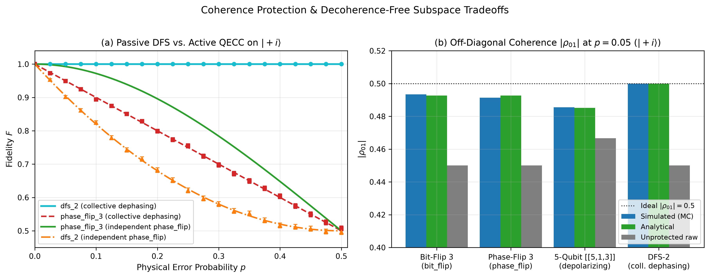
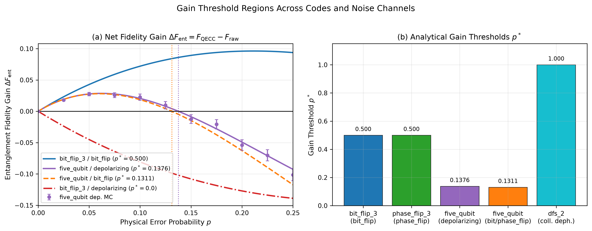
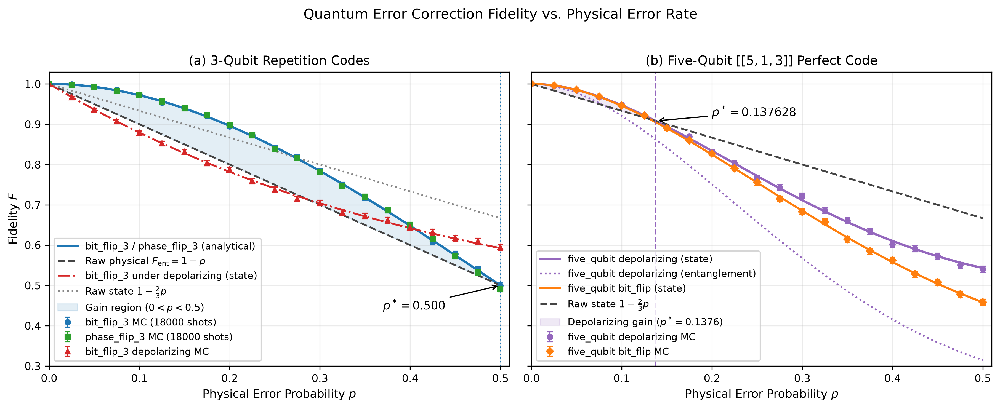

# Códigos de Correção de Erros Quânticos (QECC)
## Teoria, Circuitos Estabilizadores, Subespaços Livres de Decoerência e Simulação em GPU

**Apresentação de Seminário de Pós-Graduação**  
*Suíte de Simulação: Python 3.12 + PyTorch CUDA 13.0 (RTX 5080 `sm_120`) + `eigenkit` v1.3.0*

---

## Slide 1 — Roteiro do Seminário

1. **Por que QECC É Fundamentalmente Diferente de ECC Clássico** (não-clonagem, contínuo $SU(2)$, colapso projetivo)
2. **Discretização de Erros e Condições de Knill–Laflamme** ($E_a^\dagger E_b$, $C_{ab}\delta_{ij}$)
3. **Códigos Estabilizadores e Limite Quântico de Hamming** (`bit_flip_3`, `phase_flip_3`, código perfeito `[[5,1,3]]`)
4. **Coerência ($\rho_{01}$) e Subespaços Livres de Decoerência Passivos (`dfs_2`)**
5. **Extração Não Destrutiva de Síndrome por Ancilla e Realimentação Clássica (Feed-Forward)**
6. **Marcos Experimentais Recentes** (Google Willow, 48 qubits lógicos de Harvard, qLDPC de 288 qubits da IBM, Qubits Gato)
7. **Limiares Analíticos de Ganho, Consistência de Métricas e Benchmarks na RTX 5080**

---

## Slide 2 — Desafio 1: O Teorema da Não-Clonagem

A repetição clássica copia $b \mapsto (b, b, b)$. A mecânica quântica proíbe a cópia de estados desconhecidos.

**Prova de Wootters–Zurek (Linearidade e Unitariedade):**
- Suponha um operador unitário $U(|\psi\rangle|0\rangle) = |\psi\rangle|\psi\rangle$ e $U(|\phi\rangle|0\rangle) = |\phi\rangle|\phi\rangle$.
- A preservação do produto interno ($U^\dagger U = I$) exige:
$$\langle \psi | \phi \rangle = \langle \psi | \phi \rangle^2 \implies \langle \psi | \phi \rangle \in \{0, 1\}.$$
- Estados arbitrários não podem ser clonados; em vez disso, **emaranhamos** a informação em um subespaço de código:
$$\alpha|0\rangle + \beta|1\rangle \;\longmapsto\; \alpha|0_L\rangle + \beta|1_L\rangle.$$

---

## Slide 3 — Desafios 2 e 3: Erros Contínuos e Colapso Projetivo

- **Variedade Contínua de Erros em $SU(2)$:** Diferentemente das inversões de bit discretas em $\mathbb{F}_2^n$, o ruído físico atua continuamente na esfera de Bloch:
$$U(\theta, \hat{n}) = \exp\!\left(-i \frac{\theta}{2} \hat{n}\cdot\vec{\sigma}\right) = \cos\!\left(\frac{\theta}{2}\right) I - i \sin\!\left(\frac{\theta}{2}\right)(n_x X + n_y Y + n_z Z).$$
- **Colapso por Medição Projetiva:** Medir diretamente os qubits físicos de $\alpha|000\rangle + \beta|111\rangle$ produz $|000\rangle$ (prob. $|\alpha|^2$) ou $|111\rangle$ (prob. $|\beta|^2$), destruindo a coerência fora da diagonal $\rho_{01} = \alpha\beta^*$.
- **Requisito de Projeto:** Extrair *apenas* a paridade da síndrome de erro sem obter *nenhuma* informação sobre $\alpha$ e $\beta$.

---

## Slide 4 — Discretização de Erros via Expansão de Pauli

Qualquer operador de Kraus de um qubit $E_k$ se expande completamente na base de Pauli $\{I, X, Y, Z\}$:
$$E_k = c_{k,I} I + c_{k,X} X + c_{k,Y} Y + c_{k,Z} Z, \qquad c_{k,P} = \frac{1}{2}\operatorname{Tr}(P E_k).$$
- A atuação sobre um estado codificado cria uma superposição coerente de ramos com erros de Pauli:
$$E_k^{(q)} |\psi_L\rangle = \sum_{P \in \{I, X, Y, Z\}} c_{k,P}\, P^{(q)} |\psi_L\rangle.$$
- **Digitalização Projetiva:** Medir síndromes de estabilizadores em ancillas projeta o estado em um único subespaço de síndrome $\Pi_s$, colapsando o ruído contínuo em um erro discreto de Pauli $P_s^{(q)}$!

---

## Slide 5 — As Condições de Knill–Laflamme

**Teorema (Knill–Laflamme, 1997):** Um código $\mathcal{C} = \operatorname{span}\{|i_L\rangle\}$ com projetor $P_C$ corrige um conjunto de erros $\mathcal{E} = \{E_a\}$ se, e somente se:
$$\langle i_L | E_a^\dagger E_b | j_L \rangle = C_{ab}\delta_{ij} \qquad \Longleftrightarrow \qquad P_C E_a^\dagger E_b P_C = C_{ab} P_C,$$
em que $C_{ab}$ é uma matriz hermitiana independente dos índices lógicos $i, j$.

- **Verificado via `verify_knill_laflamme` (`tol = 1e-12`):**

| Código | Conjunto de Erros $\mathcal{E}$ | $\vert\mathcal{E}\vert$ | Violação Máxima |
|---|---|---:|---:|
| `bit_flip_3` | `III, XII, IXI, IIX` | 4 | `0.000e+00` |
| `phase_flip_3` | `III, ZII, IZI, IIZ` | 4 | `0.000e+00` |
| `five_qubit` | Todos os 16 Paulis de peso $\le 1$ | 16 | `1.972e-31` |
| `dfs_2` | Coletivo `{II, ZZ}` | 2 | `0.000e+00` |

---

## Slide 6 — Códigos de 3 Qubits de Inversão de Bit (Bit-Flip) e Inversão de Fase (Phase-Flip)

- **Código de Inversão de Bit de 3 Qubits (`bit_flip_3`):**
  - Codificação: $|0_L\rangle = |000\rangle$, $|1_L\rangle = |111\rangle$ via `CNOT(0->1), CNOT(0->2)`.
  - Estabilizadores: `ZZI`, `IZZ`; operadores lógicos $X_L = XXX$, $Z_L = ZII$.
  - Síndromes `00/10/11/01` $\to$ recuperação `III / XII / IXI / IIX`.
- **Código de Inversão de Fase de 3 Qubits (`phase_flip_3`):**
  - Dualidade de Hadamard $H^{\otimes 3}$: $|0_L\rangle = |+++\rangle$, $|1_L\rangle = |---\rangle$.
  - Estabilizadores: `XXI`, `IXX`; operadores lógicos $X_L = ZZZ$, $Z_L = XII$.
  - Síndromes `00/10/11/01` $\to$ recuperação `III / ZII / IZI / IIZ`.
- **Polinômio Analítico Compartilhado (canal de eixo único casado):**
$$F_e(p) = (1-p)^3 + 3p(1-p)^2 = 1 - 3p^2 + 2p^3 > 1 - p \quad \text{para } 0 < p < 0.5.$$

---

## Slide 7 — Limite Quântico de Hamming e Síntese para o `[[5,1,3]]`

Quão pequeno pode ser um código geral de Pauli ($k=1$) corretor de um único erro ($t=1$)?

**Limite Quântico de Hamming (Não Degenerado):**
$$2^k \sum_{w=0}^{t} \binom{n}{w} 3^w \le 2^n.$$
- $n = 3$: $2(1 + 9) = 20 > 8$ (falha)
- $n = 4$: $2(1 + 12) = 26 > 16$ (falha)
- **$n = 5$:** $2(1 + 15) = 32 = 2^5$ (**saturação exata — o código perfeito `[[5,1,3]]`!**)

Todos os $2^4 = 16$ subespaços ortogonais bidimensionais correspondem bijetivamente a `IIIII` mais os 15 erros de um qubit em `{X, Y, Z}`.

---

## Slide 8 — Código de Cinco Qubits `[[5,1,3]]`: Estabilizadores e Enumerador de 1024 Termos

- **Geradores Estabilizadores Cíclicos (`src/qecc/codes/five_qubit.py`):**
  - `S0 = XZZXI`, `S1 = IXZZX`, `S2 = XIXZZ`, `S3 = ZXIXZ`
- **Operadores Lógicos (com alinhamento de sinal `Z(0)` em `encode_ops()`):**
  - $X_L = \texttt{XXXXX} = X^{\otimes 5}$, $Z_L = \texttt{ZZZZZ} = Z^{\otimes 5}$
- **16 Síndromes Bijetivas de 4 Bits (`0000`–`1111`):**
  - `0000->IIIII`, `0001->XIIII`, `1010->ZIIII`, `1011->YIIII`, `1000->IXIII`, `0101->IZIII`, `1101->IYIII`, `1100->IIXII`, `0010->IIZII`, `1110->IIYII`, `0110->IIIXI`, `1001->IIIZI`, `1111->IIIYI`, `0011->IIIIX`, `0100->IIIIZ`, `0111->IIIIY`
- **Enumerador de Pesos de 1024 Termos (`five_qubit_weight_enumerator()`):**
  - Pesos da classe lateral lógica `I`: $A^{(I)} = [1, 15, 0, 60, 135, 45]$ (soma = 256; classes laterais $X, Y, Z$ com `[0, 0, 30, 70, 90, 66]` cada).

---

## Slide 9 — Extração Não Destrutiva de Síndrome por Ancilla

Para medir o estabilizador $S_k$ sem perturbar $\alpha|0_L\rangle + \beta|1_L\rangle$, usamos **retrocesso de fase (*phase kickback*)** na ancilla $a_k$:
$$|\psi_{\text{err}}\rangle|0\rangle_{a_k} \xrightarrow{H(a_k)} \xrightarrow{\Lambda(S_k)} \xrightarrow{H(a_k)} \frac{I + S_k}{2}|\psi_{\text{err}}\rangle|0\rangle_{a_k} + \frac{I - S_k}{2}|\psi_{\text{err}}\rangle|1\rangle_{a_k}.$$
- Para qualquer erro de Pauli $E$ com $S_k E = (-1)^{s_k} E S_k$, o estado $E(\alpha|0_L\rangle + \beta|1_L\rangle)$ é um autoestado de $S_k$:
  - A ancilla colapsa para o bit clássico de síndrome $s_k \in \{0, 1\}$ com **vazamento zero** de $\alpha, \beta$.
- **Realimentação Clássica Condicional (Feed-Forward):** O simulador fatia o tensor de estado `(B, 2^{n_data}, 2^{n_ancilla})` na `syndrome` medida, renormaliza, aplica `recovery_ops(syndrome)` e executa `decode_ops()`.

---

## Slide 10 — Subespaços Livres de Decoerência Passivos (`dfs_2`)

Em vez de realimentação ativa de síndrome, o **DFS** protege qubits lógicos em um subespaço protegido por simetria:
- **Codificação (`X(1), CNOT(0->1)`):** $\mathcal{H}_{\text{DFS}} = \operatorname{span}\{|01\rangle, |10\rangle\}$ (`n_data = 2, n_ancilla = 0`).
- **Invariância sob Defasagem Coletiva:**
$$(Z \otimes Z)|01\rangle = -|01\rangle, \qquad (Z \otimes Z)|10\rangle = -|10\rangle \implies (Z\otimes Z)|\psi_L\rangle = -|\psi_L\rangle,$$
$$(R_z(\phi) \otimes R_z(\phi))(\alpha|01\rangle + \beta|10\rangle) = \alpha|01\rangle + \beta|10\rangle \quad \forall\, \phi \in \mathbb{R}.$$
- Resultado: **$F = 1.0$ identicamente para todo $p \in [0, 1]$** sob `collective_dephasing`!
- **Compromisso por Quebra de Simetria:** Sob `phase_flip` independente, $F_e(p) = (1-p)^2 + p^2 = 1 - 2p + 2p^2 < 1 - p$ (para $p < 0.5$), enquanto `phase_flip_3` atinge $1 - 3p^2 + 2p^3$ em inversões independentes e $1 - p$ em defasagem coletiva.

---

## Slide 11 — Coerência Fora da Diagonal e Compromissos de DFS (Empírico)

- Em $p = 0.05$ no estado `|+i>` (`18,000` amostras, `torch_cuda`), coerência fora da diagonal $|\rho_{01}|$:
  - `bit_flip_3` (`bit_flip`): `0.493389` MC vs. `0.492750` analítico vs. `0.450000` sem codificação
  - `phase_flip_3` (`phase_flip`): `0.491333` MC vs. `0.492750` analítico vs. `0.450000` sem codificação
  - `five_qubit` (`depolarizing`): `0.485556` MC vs. `0.485112` analítico vs. `0.466667` sem codificação
  - `dfs_2` (`collective_dephasing`): `0.500000` MC vs. `0.500000` analítico vs. `0.450000` sem codificação

---

## Slide 12 — Desenvolvimentos Recentes (1/2): Teorema do Limiar, Willow e Átomos Neutros

- **Teorema do Limiar e Códigos de Superfície:** Abaixo do limiar de circuito $p_{\text{th}}$, o erro lógico decai exponencialmente $\epsilon_L \propto (p/p_{\text{th}})^{(d+1)/2}$.
- **Google Quantum AI Willow (Nature 2025):**
  - Escalonamento do código de superfície rotacionado $d = 3 \to 5 \to 7$ em 105 qubits.
  - Fator de supressão de erros abaixo do limiar **$\Lambda = 2.14 \pm 0.02$** por passo de distância; erro lógico de **`0.143%`** por ciclo em $d = 7$ ($2.4\times$ além do ponto de equilíbrio físico).
- **Processador de Átomos Neutros de Harvard / Lukin (Bluvstein et al., Nature 2024):**
  - Transporte coerente por pinças ópticas viabilizando **`48` qubits lógicos** (280 átomos físicos) com códigos `[[8,3,2]]` e portas lógicas transversais.

---

## Slide 13 — Desenvolvimentos Recentes (2/2): qLDPC da IBM e Qubits Gato (Cat Qubits) Bosônicos

- **Códigos qLDPC *Bivariate Bicycle* da IBM (Bravyi et al., Nature 2024):**
  - Superam limites bidimensionais de taxa com verificações não locais de peso 6: o código *gross* `[[144,12,12]]` codifica 12 qubits lógicos à distância 12 usando **`288` qubits físicos** (limiar de circuito `~0.7%`, economia de $\sim 10\times$ em qubits em relação ao código de superfície).
- **Qubits Gato (Cat Qubits) Bosônicos com Ruído Assimétrico em Hardware (Alice & Bob / Réglade et al. 2024; AWS / Putterman et al. 2025):**
  - A dissipação de dois fótons estabiliza $|\pm\alpha\rangle$, produzindo **supressão exponencial de inversão de bit (bit-flip)** ($\propto e^{-2|\alpha|^2}$), de modo que códigos externos de repetição ou de superfície precisam suprimir apenas inversões de fase (phase-flips).

---

## Slide 14 — Limiares Analíticos de Ganho e Consistência de Métricas

**Duas definições distintas de fidelidade NUNCA devem ser misturadas:**
- **Fidelidade de Emaranhamento ($F_e$):** $F_e(p) = P_I(p)$, comparada à referência sem codificação **$F_{e,\text{raw}}(p) = 1 - p$**.
- **Fidelidade Média de Estado (Média de Haar, $F_{\text{state}}$):**
$$F_{\text{state}}(p) = 1 - \frac{2}{3}\bigl(1 - F_e(p)\bigr), \qquad F_{\text{state,raw}}(p) = 1 - \frac{2}{3}p.$$
- **Alerta de Separação de Métricas:** Comparar $F_{\text{state}}(p)$ contra $1 - p$ cria uma **incompatibilidade de vantagem espúria/falsa**. Comparar $F_e$ vs. $1 - p$ ou $F_{\text{state}}$ vs. $1 - \frac{2}{3}p$ preserva **exatamente o mesmo limiar analítico de ganho $p^*$**!

---

## Slide 15 — Limiares de Ganho Exatos via `brentq` em Todos os Códigos

| Código | Canal | $p^*$ Exato (`brentq`) | Região de Ganho |
|---|---|---:|---|
| `bit_flip_3` | `bit_flip` | `0.5` (`0.5000`) | $0 < p < 0.5$ |
| `phase_flip_3` | `phase_flip` | `0.5` (`0.5000`) | $0 < p < 0.5$ |
| `five_qubit` | `depolarizing` | `0.1376275643` (`0.1376`) | $0 < p < 0.1376$ |
| `five_qubit` | `bit_flip` / `phase_flip` | `0.1311231479` (`0.1311`) | $0 < p < 0.1311$ |
| `dfs_2` | `collective_dephasing` | `1.0` (`1.0000`) | $0 < p < 1.0$ |

---

## Slide 16 — Varreduras Monte Carlo (`18,000` Amostras na RTX 5080 `torch_cuda`)

- `231` registros em `21` pontos de $p \in [0, 0.5]$ (`seed = 20261118`):
  - Em $p = 0.0$: $|F_{\text{sim}} - 1.0| \le 2.776 \times 10^{-15}$.
  - Nos `180` pontos Monte Carlo com $p > 0$ (`160` pontos de variância não nula excluindo os `20` pontos exatos de `dfs_2 / collective_dephasing` com $F=1.0$ e `std_error=0.0`): máx. `std_error = 0.003727`, máx. $|z| = 3.3430$, confirmando concordância analítica.

---

## Slide 17 — Arquitetura Híbrida de Backends e Avaliação do `eigenkit`

- **Verificação Técnica do `eigenkit` v1.3.0 (`docs/pt-br/eigenkit_evaluation.md`):**
  - Motor unitário limpo de vetor de estado (*big-endian*) (`Circuit(..., provider="numpy").statevector(...)`).
  - **Lacunas confirmadas para QECC:** ausência de `measure` no meio do circuito, realimentação clássica condicional `c_if` (feed-forward), ruído estocástico de Pauli/Kraus (`sample()` lança `NotImplementedError`), `partial_trace` (traço parcial) e kernels PyTorch `sm_120` para RTX 5080 (`CudaQuantumBackend` não possui `.statevector()`, omite 6 portas de IR e fixa `pytorch-cu126`).
- **3 Implementações Intercambiáveis de `QECCBackend` (`src/qecc/backends/`):**
  1. `numpy` (`NumPyCPUBackend`): referência vetorizada em CPU `complex128`.
  2. `torch_cuda` (`TorchCUDABackend`): motor GPU nativo `torch==2.14.1+cu130` (`sm_120`).
  3. `eigenkit_unitary` (`EigenkitUnitaryAdapter`): verificador cruzado unitário (`p=0` e erros determinísticos; `stochastic_supported=false`).

---

## Slide 18 — Benchmarks CUDA na RTX 5080 e Paridade Unitária

- **Paridade Estocástica (`numpy` vs. `torch_cuda`, `p=0.05`, `|+i>`):** `9/9 APROVADO`.
- **Paridade Unitária (`eigenkit_unitary` vs. `numpy`/`torch_cuda`):** `6/6 APROVADO`, máx. `|Δρ| <= 1.06e-15` no geral (`<= 1.52e-17` entre `eigenkit_unitary` e `numpy`).

| Caso de Benchmark | Amostras (Shots) | CPU (`numpy`) | GPU (`torch_cuda` RTX 5080) | Aceleração CUDA |
|---|---:|---:|---:|---:|
| `bit_flip_3 / bit_flip` | `100,000` | `0.179347 s` | `0.022497 s` | `7.97x` |
| `phase_flip_3 / phase_flip` | `100,000` | `0.334624 s` | `0.026219 s` | `12.76x` |
| `five_qubit / depolarizing` | `10,000` | `0.911476 s` | `0.064071 s` | `14.23x` |
| `five_qubit / depolarizing` | `100,000` | `10.080841 s` | `0.413090 s` | **`24.40x`** |

---

## Slide 19 — Conclusões e Reprodutibilidade

- **Teoria e Experimento Unificados:** Verificações exatas das condições de Knill–Laflamme (`<= 1.972e-31`), enumerador de pesos de 1024 termos, limiares via `brentq` (`0.5`, `0.137628`, `0.131123`, `1.0`), varreduras de 18k amostras e aceleração de `24.40x` na GPU RTX 5080 concordam plenamente.
- **Mensagem Principal:** Sempre separe a fidelidade de emaranhamento ($1 - p$) da fidelidade média de estado (média de Haar, $1 - \frac{2}{3}p$) ao avaliar limiares de ponto de equilíbrio em QECC.
- **Reprodução:**
  - `.venv/bin/python scripts/verify_analytical_thresholds.py`
  - `.venv/bin/python scripts/run_sweeps.py`
  - `.venv/bin/python scripts/run_benchmarks.py`
  - `.venv/bin/pytest tests/unit tests/e2e -v`
