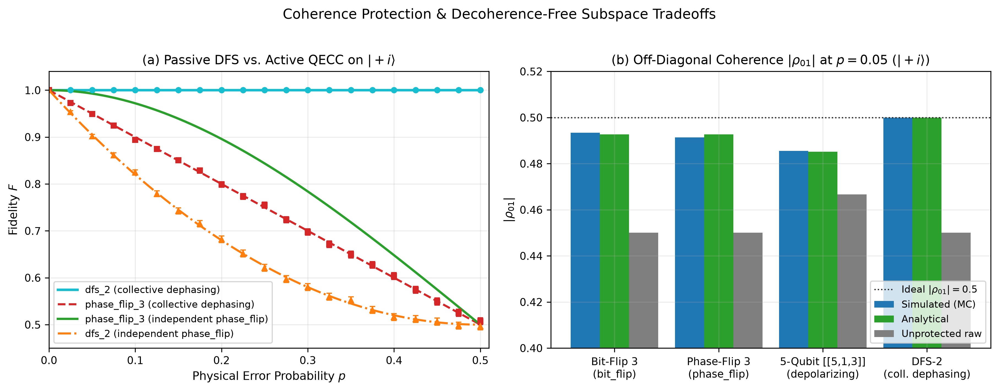
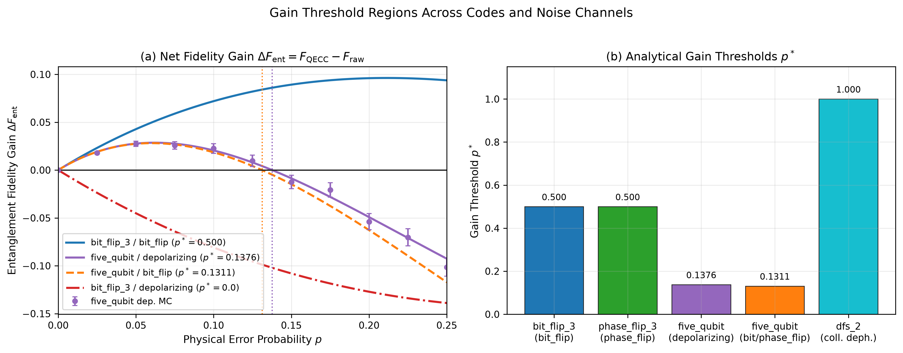
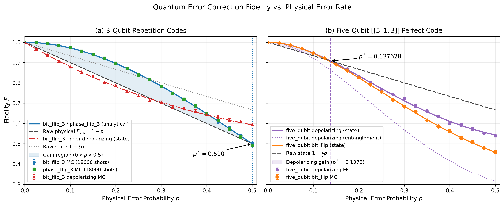

# Quantum Error Correction Codes: Theory, Stabilizer Circuits, Decoherence-Free Subspaces, and GPU-Accelerated Gain-Threshold Analysis

**Abstract.** Quantum information promises exponential speedups for simulation, cryptography, and linear-algebraic primitives, yet physical qubits suffer continuously from amplitude damping, dephasing, and control imperfections that destroy coherent superpositions on microsecond timescales. Unlike classical bits, unknown quantum states cannot be cloned, experience a continuous $SU(2)$ error manifold, and collapse irreversibly under direct projective measurement. This seminar manuscript presents a self-contained graduate-level treatment of quantum error correction codes (QECCs) unifying analytical theory with reproducible numerical verification on an NVIDIA RTX 5080 (`sm_120`) GPU simulation suite. We prove the Wootters–Zurek no-cloning theorem, derive error discretization via Pauli expansion and the formal Knill–Laflamme conditions, construct the 3-qubit bit-flip and phase-flip codes, synthesize the `[[5,1,3]]` Laflamme perfect code saturating the quantum Hamming bound (including its exact stabilizer generators, 16-syndrome lookup table, and 1024-term weight enumerator), and contrast active stabilizer recovery with passive two-qubit decoherence-free subspaces (DFS). We analyze non-destructive ancilla syndrome extraction and classical conditional feed-forward, survey recent hardware milestones (Google Willow, Harvard/Lukin neutral-atom logical processors, IBM bivariate-bicycle qLDPC codes, and bosonic cat qubits), and derive exact analytical gain thresholds $p^*$ separating entanglement fidelity ($1 - p$) from Haar-averaged state fidelity ($1 - \frac{2}{3}p$) to eliminate metric-comparison fallacies. Every theoretical claim is cross-checked against our open-source Python/CUDA simulator (`numpy`, `torch_cuda`, and `eigenkit_unitary`).

---

## Table of Contents

1. [Fundamental Challenges of Quantum Error Correction vs. Classical Error Correction](#1-fundamental-challenges-of-quantum-error-correction-vs-classical-error-correction)
2. [Error Discretization and the Knill-Laflamme Conditions](#2-error-discretization-and-the-knill-laflamme-conditions)
3. [Stabilizer Codes, Quantum Hamming Bound, Coherence Protection, and Decoherence-Free Subspaces](#3-stabilizer-codes-quantum-hamming-bound-coherence-protection-and-decoherence-free-subspaces)
4. [Non-Destructive Ancilla Syndrome Extraction and Classical Feed-Forward](#4-non-destructive-ancilla-syndrome-extraction-and-classical-feed-forward)
5. [Recent Developments in Quantum Error Correction](#5-recent-developments-in-quantum-error-correction)
6. [Analytical Gain Thresholds, Metric Consistency, and Empirical Simulation Results](#6-analytical-gain-thresholds-metric-consistency-and-empirical-simulation-results)
7. [Conclusion and Reproducibility Summary](#7-conclusion-and-reproducibility-summary)

---

## 1. Fundamental Challenges of Quantum Error Correction vs. Classical Error Correction

Classical error correction (ECC) rests on three foundational operations that appear almost trivial in digital electronics: (i) copying a bit $b \in \{0, 1\}$ into redundant physical registers $b \mapsto (b, b, b)$ before transmission, (ii) treating channel noise as a discrete set of bit-flip events $b \mapsto b \oplus e$ over $\mathbb{F}_2$, and (iii) directly reading every physical bit at the receiver to compute parity checks and apply majority voting. Every single one of these three classical pillars fails in quantum mechanics.

### 1.1 The No-Cloning Theorem

In classical repetition coding, redundancy is created by fanning out an unknown state $b$ into multiple identical copies. In quantum mechanics, linearity and unitarity strictly forbid an arbitrary-state cloning machine.

**Theorem (Wootters–Zurek–Dieks No-Cloning Theorem).** *There exists no unitary operator $U$ acting on $\mathcal{H}_A \otimes \mathcal{H}_B$ (with $\dim \mathcal{H}_A = \dim \mathcal{H}_B \ge 2$) and fixed blank state $|0\rangle_B$ such that $U(|\psi\rangle_A \otimes |0\rangle_B) = |\psi\rangle_A \otimes |\psi\rangle_B$ for all normalized states $|\psi\rangle \in \mathcal{H}_A$.*

**Proof (Linearity and Inner-Product Preservation).** Suppose such a unitary cloner $U$ exists, and let $|\psi\rangle, |\phi\rangle \in \mathcal{H}_A$ be two arbitrary normalized states. By assumption,
$$U(|\psi\rangle \otimes |0\rangle) = |\psi\rangle \otimes |\psi\rangle, \qquad U(|\phi\rangle \otimes |0\rangle) = |\phi\rangle \otimes |\phi\rangle.$$
Because $U$ is unitary, it preserves the Hilbert-space inner product ($U^\dagger U = I$):
$$\langle \psi | \phi \rangle = (\langle \psi | \otimes \langle 0 |)(|\phi\rangle \otimes |0\rangle) = (\langle \psi | \otimes \langle 0 |) U^\dagger U (|\phi\rangle \otimes |0\rangle) = (\langle \psi | \otimes \langle \psi |)(|\phi\rangle \otimes |\phi\rangle) = \langle \psi | \phi \rangle^2.$$
The scalar equation $z = z^2$ for $z = \langle \psi | \phi \rangle \in \mathbb{C}$ has only two solutions: $z = 0$ (orthogonal states) or $z = 1$ (identical states up to global phase). Equivalently, by linearity, cloning $|\psi\rangle = \alpha|0\rangle + \beta|1\rangle$ produces $\alpha|00\rangle + \beta|11\rangle$ rather than the tensor product $(\alpha|0\rangle + \beta|1\rangle)^{\otimes 2} = \alpha^2|00\rangle + \alpha\beta(|01\rangle + |10\rangle) + \beta^2|11\rangle$ whenever $\alpha\beta \neq 0$. Thus, quantum codes cannot duplicate unknown states; instead, they must *entangle* the logical information across a multi-qubit subspace:
$$\alpha|0\rangle + \beta|1\rangle \;\longmapsto\; \alpha|0_L\rangle + \beta|1_L\rangle.$$

### 1.2 Continuous Error Space ($SU(2)$ and the Bloch Sphere)

A classical bit suffers only discrete inversion ($0 \leftrightarrow 1$). By contrast, a single qubit state $|\psi\rangle = \alpha|0\rangle + \beta|1\rangle$ (with $|\alpha|^2 + |\beta|^2 = 1$) lives on the Bloch sphere $\mathbb{CP}^1 \cong S^2$, and unitary noise acts on the continuous Lie group $SU(2)$:
$$U(\theta, \hat{n}) = \exp\!\left(-i \frac{\theta}{2} \hat{n}\cdot\vec{\sigma}\right) = \cos\!\left(\frac{\theta}{2}\right) I - i \sin\!\left(\frac{\theta}{2}\right)(n_x X + n_y Y + n_z Z),$$
where $\theta \in [0, 4\pi)$ and $\hat{n} \in S^2$ are continuous real parameters. Even more generally, open-system interactions with an environment $\mathcal{H}_E$ evolve the joint state unitarily and induce a completely positive trace-preserving (CPTP) quantum channel $\mathcal{E}(\rho) = \sum_k E_k \rho E_k^\dagger$ with continuous Kraus operators $E_k \in \mathbb{C}^{2 \times 2}$ satisfying $\sum_k E_k^\dagger E_k = I$. Both bit-flip errors ($X$-type rotations) and phase-flip errors ($Z$-type dephasing of relative phase $\arg(\alpha^*\beta)$), as well as infinitesimal coherent over-rotations $\theta \ll 1$, accumulate continuously. Without active discretization, a decoder cannot simply measure a finite-precision analog angle $\theta$ and subtract it.

### 1.3 Projective Collapse Under Direct Measurement

Classical decoders read every physical wire $y_i \in \{0, 1\}$ directly and compute parity checks $H y \pmod 2$. If we attempt to measure a physical data qubit of an encoded state $|\psi_L\rangle = \alpha|000\rangle + \beta|111\rangle$ in the computational basis $\{|0\rangle, |1\rangle\}$, the projective Born rule yields outcome $0$ with probability $|\alpha|^2$ (collapsing the state to $|000\rangle$) and outcome $1$ with probability $|\beta|^2$ (collapsing the state to $|111\rangle$). In both branches, the off-diagonal coherence $\rho_{01} = \alpha\beta^*$ is completely erased! Quantum error correction must therefore extract *only* information about *which error occurred* while learning *zero* information about the logical amplitudes $\alpha$ and $\beta$.

| Dimension | Classical ECC | Quantum Error Correction (QECC) |
|---|---|---|
| **Redundancy mechanism** | Fan-out cloning $b \mapsto (b, b, \dots, b)$ | Entangled code subspace $\alpha\vert 0_L\rangle + \beta\vert 1_L\rangle$ (no-cloning forbids $\vert\psi\rangle^{\otimes n}$) |
| **Error manifold** | Discrete bit flips over $\mathbb{F}_2^n$ | Continuous $SU(2)^{\otimes n}$ / CPTP Kraus maps (bit, phase, coherent rotations) |
| **Syndrome readout** | Direct bit readout followed by parity XOR | Non-destructive ancilla measurement of stabilizer generators $S_k$ |
| **Failure mode of direct measurement** | None (readout is non-destructive) | Projective collapse destroys superposition and off-diagonal coherence $\rho_{01}$ |

---

## 2. Error Discretization and the Knill-Laflamme Conditions

### 2.1 Pauli Basis Expansion

The single-qubit Pauli matrices $\{I, X, Y, Z\}$ form an orthonormal basis (under the Hilbert–Schmidt inner product $\frac{1}{2}\operatorname{Tr}(P^\dagger Q) = \delta_{PQ}$) for the space $\mathbb{C}^{2 \times 2}$ of all single-qubit linear operators:
$$I = \begin{pmatrix} 1 & 0 \\ 0 & 1 \end{pmatrix}, \quad X = \begin{pmatrix} 0 & 1 \\ 1 & 0 \end{pmatrix}, \quad Y = \begin{pmatrix} 0 & -i \\ i & 0 \end{pmatrix}, \quad Z = \begin{pmatrix} 1 & 0 \\ 0 & -1 \end{pmatrix}.$$
Consequently, **any** single-qubit Kraus operator $E_k$ can be written as a complex linear combination
$$E_k = c_{k,I} I + c_{k,X} X + c_{k,Y} Y + c_{k,Z} Z, \qquad c_{k,P} = \frac{1}{2}\operatorname{Tr}(P E_k).$$
On an $n$-qubit register, the $4^n$ tensor-product Pauli strings $P \in \{I, X, Y, Z\}^{\otimes n}$ form a complete operator basis for $\mathbb{C}^{2^n \times 2^n}$. Any $n$-qubit Kraus operator $E_k$ acting at most on weight-$t$ qubits decomposes as $E_k = \sum_{\operatorname{wt}(P) \le t} c_{k,P} P$.

### 2.2 Projective Discretization via Syndrome Measurement

Suppose a code $\mathcal{C} \subset (\mathbb{C}^2)^{\otimes n}$ is protected by a commuting set of Pauli stabilizer checks $\{S_1, \dots, S_r\}$ such that every correctable Pauli error $P \in \mathcal{E}_{\text{Pauli}}$ produces a unique syndrome bitstring $s(P) \in \{0, 1\}^r$ (or falls into a degenerate coset $P S$ with identical recovery). When a continuous single-qubit error $E_k = \sum_{P \in \{I,X,Y,Z\}} c_{k,P} P$ acts on qubit $q$ of an arbitrary encoded state $|\psi_L\rangle \in \mathcal{C}$, the corrupted state is a *coherent superposition* of Pauli-errored branches:
$$E_k^{(q)} |\psi_L\rangle = \sum_{P \in \{I, X, Y, Z\}} c_{k,P}\, P^{(q)} |\psi_L\rangle.$$
Crucially, when we perform projective syndrome measurement of the stabilizers onto ancilla qubits, the measurement projects the continuous superposition onto a *single* syndrome subspace $\Pi_s$ with probability $p_s = \| \Pi_s E_k^{(q)} |\psi_L\rangle \|^2$:
$$\Pi_s E_k^{(q)} |\psi_L\rangle = c_{k,P_s}\, P_s^{(q)} |\psi_L\rangle.$$
Up to a scalar normalization factor, the continuous error $E_k$ has *collapsed* into a discrete, exact Pauli error $P_s^{(q)}$! Applying the discrete unitary recovery $R_s = P_s^{(q)\dagger} = P_s^{(q)}$ restores $|\psi_L\rangle$ with unit fidelity. In other words, **measuring the error syndrome digitizes continuous quantum errors into discrete Pauli errors**.

### 2.3 Formal Knill-Laflamme Necessary and Sufficient Conditions

Which codes $\mathcal{C}$ and error sets $\mathcal{E} = \{E_a\}$ admit exact error correction? This is answered completely by the Knill–Laflamme theorem (1997).

**Theorem (Knill–Laflamme Quantum Error Correction Conditions).** *Let $\mathcal{C} \subset \mathcal{H}$ be a $2^k$-dimensional code subspace with orthogonal projector $P_C = \sum_{i=0}^{2^k - 1} |i_L\rangle\langle i_L|$, and let $\mathcal{E} = \{E_a\}$ be a set of Kraus error operators representing a quantum channel $\mathcal{E}(\rho) = \sum_a E_a \rho E_a^\dagger$. There exists a CPTP recovery channel $\mathcal{R}$ such that $(\mathcal{R} \circ \mathcal{E})(\rho) = \rho$ for all $\rho$ supported on $\mathcal{C}$ if and only if for all $E_a, E_b \in \mathcal{E}$ and all orthonormal logical basis states $|i_L\rangle, |j_L\rangle \in \mathcal{C}$:*
$$\langle i_L | E_a^\dagger E_b | j_L \rangle = C_{ab} \delta_{ij},$$
*or equivalently in projector form:*
$$P_C E_a^\dagger E_b P_C = C_{ab} P_C,$$
*where $C = (C_{ab})$ is a Hermitian matrix ($C_{ab}^* = C_{ba}$) independent of the logical indices $i, j$.*

**Physical Interpretation.** The Knill–Laflamme condition encodes two simultaneous constraints:
1. **Orthogonality of distinct logical branches ($i \neq j$):** $\langle i_L | E_a^\dagger E_b | j_L \rangle = 0$ ensures that errors $E_a, E_b$ cannot map orthogonal codewords $|i_L\rangle, |j_L\rangle$ into overlapping corrupted states, preventing irreversible mixing of logical states.
2. **Logical state independence ($i = j$):** $\langle i_L | E_a^\dagger E_b | i_L \rangle = C_{ab}$ is identical for every $|i_L\rangle$ (including any superposition, since $P_C E_a^\dagger E_b P_C = C_{ab} P_C$). Consequently, no environment interaction or syndrome measurement inside $\mathcal{E}$ can learn any information about the encoded logical state $|\psi_L\rangle$.

**Proof Sketch (Sufficiency via Diagonalization of $C$).** Since $C_{ab}$ is Hermitian, there exists a unitary matrix $u$ diagonalizing $C$: $(u^\dagger C u)_{kl} = d_k \delta_{kl}$ with real eigenvalues $d_k \ge 0$ (positivity follows from $P_C (\sum_a v_a^* E_a^\dagger)(\sum_b v_b E_b) P_C \ge 0$). Defining rotated Kraus operators $F_k = \sum_a u_{ak} E_a$ yields
$$P_C F_k^\dagger F_l P_C = d_k \delta_{kl} P_C.$$
For every $k$ with $d_k > 0$, polar decomposition of $F_k P_C$ yields a partial isometry $U_k$ ($U_k^\dagger U_k = P_C$) such that $F_k P_C = \sqrt{d_k}\, U_k P_C$. The projectors $\Pi_k = U_k P_C U_k^\dagger$ are mutually orthogonal ($\Pi_k \Pi_l = 0$ for $k \neq l$ because $P_C F_k^\dagger F_l P_C = 0$). Measuring $\{\Pi_k\}$ (plus a complement $\Pi_\perp = I - \sum_k \Pi_k$) and applying $U_k^\dagger$ defines the recovery map $\mathcal{R}(\sigma) = \sum_{d_k > 0} U_k^\dagger \Pi_k \sigma \Pi_k U_k + \Pi_\perp \sigma \Pi_\perp$ (with arbitrary map on $\Pi_\perp$), which satisfies $\mathcal{R}(E_a |\psi_L\rangle\langle\psi_L| E_a^\dagger) \propto |\psi_L\rangle\langle\psi_L|$ and recovers $\rho$ identically. By linearity of $\mathcal{R}$, any operator in $\operatorname{span}(\mathcal{E})$ is also corrected—establishing discretization directly from the Knill–Laflamme matrix condition!

### 2.4 Numerical Verification of Knill–Laflamme Conditions

In our simulation suite (`src/qecc/analysis/analytical.py::verify_knill_laflamme`), we explicitly prepare $|0_L\rangle$ and $|1_L\rangle$ via each code's `encode_ops()`, evaluate all matrix elements $\langle i_L | E_a^\dagger E_b | j_L \rangle$, and verify both $|\langle 0_L|E_a^\dagger E_b|0_L\rangle - \langle 1_L|E_a^\dagger E_b|1_L\rangle| \le 10^{-12}$ and $|\langle 0_L|E_a^\dagger E_b|1_L\rangle| \le 10^{-12}$. Running `scripts/verify_analytical_thresholds.py` yields:

| Code | Error Set $\mathcal{E}$ | $\vert\mathcal{E}\vert$ | Max Diagonal Diff | Max Off-Diagonal | Max Violation | Status |
|---|---|---:|---:|---:|---:|---|
| `bit_flip_3` | `III, XII, IXI, IIX` | 4 | `0.000e+00` | `0.000e+00` | `0.000e+00` | Verified |
| `phase_flip_3` | `III, ZII, IZI, IIZ` | 4 | `0.000e+00` | `0.000e+00` | `0.000e+00` | Verified |
| `five_qubit` | All 16 single-qubit `{I,X,Y,Z}` Paulis | 16 | `1.972e-31` | `9.861e-32` | `1.972e-31` | Verified |
| `dfs_2` | Collective dephasing `{II, ZZ}` | 2 | `0.000e+00` | `0.000e+00` | `0.000e+00` | Verified |

---

## 3. Stabilizer Codes, Quantum Hamming Bound, Coherence Protection, and Decoherence-Free Subspaces

In the stabilizer formalism (Gottesman, 1997), an `[[n, k, d]]` quantum code encodes $k$ logical qubits into $n$ physical data qubits as the simultaneous $+1$ eigenspace of an Abelian subgroup $\mathcal{S} \subset \mathcal{P}_n$ (excluding $-I^{\otimes n}$) generated by $n - k$ independent commuting Pauli strings $\{S_1, \dots, S_{n-k}\}$:
$$\mathcal{C} = \bigl\{ |\psi\rangle \in (\mathbb{C}^2)^{\otimes n} \;:\; S_m |\psi\rangle = +|\psi\rangle \;\; \forall\, m \in \{1, \dots, n-k\} \bigr\}.$$
The code distance $d$ is the minimum Pauli weight of any operator in $N(\mathcal{S}) \setminus \mathcal{S}$ (logical operators commuting with all stabilizers without belonging to $\mathcal{S}$), enabling correction of any arbitrary error of weight $t = \lfloor (d - 1)/2 \rfloor$.

### 3.1 The 3-Qubit Bit-Flip Code (`bit_flip_3`, `[[3,1,1]]`)

The 3-qubit bit-flip repetition code protects against single-qubit $X$ errors (`bit_flip`), though its distance against arbitrary Paulis is $d=1$ (because single-qubit $Z$ errors commute with all $Z$-type stabilizers and act as logical $Z_L$).

- **Encoding (`encode_ops`):** Starting from $|\psi\rangle_0 |0\rangle_1 |0\rangle_2 = (\alpha|0\rangle + \beta|1\rangle)|00\rangle$, applying `CNOT(0->1)` and `CNOT(0->2)` produces
  $$|0_L\rangle = |000\rangle, \qquad |1_L\rangle = |111\rangle, \qquad |\psi_L\rangle = \alpha|000\rangle + \beta|111\rangle.$$
- **Stabilizer Generators & Logical Operators:** $\mathcal{S} = \langle ZZI, IZZ \rangle$ (`n_data = 3`, `n_ancilla = 2`, `n_total = 5`). Logical operators are $X_L = XXX$ and $Z_L = ZII$ (equivalent to $IZI, IIZ, ZZZ$ modulo $\mathcal{S}$).
- **4-Syndrome Table (`a3 a4`):** Measuring `ZZI` on ancilla 3 and `IZZ` on ancilla 4 yields syndrome bit $s_k = 0$ if the error commutes with $S_k$ and $s_k = 1$ if it anticommutes:

| Syndrome (`a3 a4`) | Single-Qubit Error | Recovery Operation | Weight-2 Aliasing Failure Example |
|---|---|---|---|
| `00` | `III` (no error) | `III` (no-op) | `XXX` (uncorrectable logical flip) |
| `10` | `XII` ($X_0$) | `XII` (`X(0)`) | `IXX` triggers `10` $\to$ `XII` applies $XXX = X_L$ |
| `11` | `IXI` ($X_1$) | `IXI` (`X(1)`) | `XIX` triggers `11` $\to$ `IXI` applies $XXX = X_L$ |
| `01` | `IIX` ($X_2$) | `IIX` (`X(2)`) | `XXI` triggers `01` $\to$ `IIX` applies $XXX = X_L$ |

Because only $2^2 = 4$ syndromes exist, every weight-2 bit-flip error aliases onto a single-qubit syndrome and causes majority-vote recovery to complete a logical $X_L = XXX$ flip.

### 3.2 The 3-Qubit Phase-Flip Code (`phase_flip_3`, `[[3,1,1]]`)

By Hadamard conjugation $H X H = Z$ and $H Z H = X$, applying $H^{\otimes 3}$ to the bit-flip code maps bit-flip protection onto phase-flip ($Z$) protection without altering algebraic error-correction properties.

- **Encoding (`encode_ops`):** `CNOT(0->1)`, `CNOT(0->2)`, followed by `H(0), H(1), H(2)` yields
  $$|0_L\rangle = |+++\rangle, \qquad |1_L\rangle = |---\rangle, \qquad |\psi_L\rangle = \alpha|+++\rangle + \beta|---\rangle.$$
- **Stabilizer Generators & Logical Operators:** $\mathcal{S} = \langle XXI, IXX \rangle$. Logical operators are $X_L = ZZZ$ and $Z_L = XII$ (equivalent to $XXX$ modulo $\mathcal{S}$).
- **4-Syndrome Table (`a3 a4`):**
  - `00` $\to$ `III` (no-op)
  - `10` $\to$ `ZII` (`Z(0)`)
  - `11` $\to$ `IZI` (`Z(1)`)
  - `01` $\to$ `IIZ` (`Z(2)`)

Both `bit_flip_3` and `phase_flip_3` fail against orthogonal noise (`Z` on `bit_flip_3` and `X` on `phase_flip_3`), motivating codes that protect against *all three* Pauli errors $X, Y, Z$ simultaneously.

### 3.3 The Quantum Hamming Bound and the `[[5,1,3]]` Perfect Code

How many physical qubits $n$ are required to encode $k = 1$ logical qubit and correct any $t = 1$ arbitrary single-qubit error ($X, Y,$ or $Z$)?

**Quantum Hamming Bound (Non-Degenerate Sphere-Packing Bound).** Each error of weight $w \in \{0, \dots, t\}$ chooses $\binom{n}{w}$ physical qubits and assigns one of $3$ non-identity Paulis $\{X, Y, Z\}$ to each erroneous site. Thus the number of distinct correctable Pauli errors up to weight $t$ is $\sum_{w=0}^t \binom{n}{w} 3^w$. Each error maps the $2^k$-dimensional code subspace into an orthogonal $2^k$-dimensional subspace inside $(\mathbb{C}^2)^{\otimes n}$. Disjointness requires:
$$2^k \sum_{w=0}^{t} \binom{n}{w} 3^w \le 2^n.$$
For $k = 1$ and $t = 1$, this becomes $2(1 + 3n) \le 2^n$:
- $n = 3$: $2(10) = 20 > 8$ (impossible)
- $n = 4$: $2(13) = 26 > 16$ (impossible)
- $n = 5$: $2(1 + 15) = 32 = 2^5$ (**exact equality!**)

Because $n = 5$ saturates the quantum Hamming bound with zero unused syndrome subspaces, the `[[5,1,3]]` Laflamme–Miquel–Paz–Zurek (1996) code is a **perfect quantum error-correcting code**: all $2^{n-k} = 2^4 = 16$ orthogonal 2-dimensional subspaces of $(\mathbb{C}^2)^{\otimes 5}$ are exhausted by the code space (`IIIII`) plus the $15$ weight-1 Pauli errors.

#### Stabilizer Generators, Logical Operators, and Exact Basis States (`src/qecc/codes/five_qubit.py`)

The four cyclic stabilizer generators of our `FiveQubitPerfectCode` (`n_data = 5`, `n_ancilla = 4`, `n_total = 9`) are:
$$S_0 = \texttt{XZZXI}, \qquad S_1 = \texttt{IXZZX}, \qquad S_2 = \texttt{XIXZZ}, \qquad S_3 = \texttt{ZXIXZ}.$$
Notice that any two generators overlap on an even number of anti-commuting $(X, Z)$ positions (e.g., $S_0$ and $S_1$ differ into $(X,I), (Z,X), (Z,Z), (X,Z), (I,X)$, giving two anticommuting pairs at qubits 1 and 3, so $[S_0, S_1] = 0$), and every generator has weight 4 and is Hermitian ($S_k^2 = I^{\otimes 5}$).

The logical operators are $X_L = \texttt{XXXXX} = X^{\otimes 5}$ and $Z_L = \texttt{ZZZZZ} = Z^{\otimes 5}$, which anticommute ($X_L Z_L = (-1)^5 Z_L X_L = -Z_L X_L$) and commute with all four generators (each generator has two $X$'s and two $Z$'s, yielding even overlap with both $X^{\otimes 5}$ and $Z^{\otimes 5}$).

In `FiveQubitPerfectCode.encode_ops()`, the 16-gate encoder applies `Z(0), H(0)`, fans out `CNOT(0->1..4)`, applies `H(0..4)`, and finishes with the ring of five graph-state entanglers `CZ(0,1), CZ(0,4), CZ(1,2), CZ(2,3), CZ(3,4)`. Including the initial `Z(0)` sign-alignment gate guarantees the exact standard sign convention $X_L|0_L\rangle = +|1_L\rangle$, $Z_L|0_L\rangle = +|0_L\rangle$, and $Z_L|1_L\rangle = -|1_L\rangle$:
$$|0_L\rangle = \frac{1}{4}\bigl(|00000\rangle - |00011\rangle + |00101\rangle - |00110\rangle + |01001\rangle + |01010\rangle - |01100\rangle - |01111\rangle - |10001\rangle + |10010\rangle + |10100\rangle - |10111\rangle - |11000\rangle - |11011\rangle - |11101\rangle - |11110\rangle\bigr),$$
$$|1_L\rangle = \frac{1}{4}\bigl(-|00001\rangle - |00010\rangle - |00100\rangle - |00111\rangle - |01000\rangle + |01011\rangle + |01101\rangle - |01110\rangle - |10000\rangle - |10011\rangle + |10101\rangle + |10110\rangle - |11001\rangle + |11010\rangle - |11100\rangle + |11111\rangle\bigr).$$

#### Complete 16-Syndrome Table for `[[5,1,3]]`

Each syndrome bitstring $s_0 s_1 s_2 s_3$ (read from ancilla qubits `a5 a6 a7 a8`) records anticommutation ($1$) or commutation ($0$) with $(S_0, S_1, S_2, S_3) = (\texttt{XZZXI}, \texttt{IXZZX}, \texttt{XIXZZ}, \texttt{ZXIXZ})$:

| Syndrome (`a5 a6 a7 a8`) | Error Pauli | Recovery Gate | Target Qubit | Commutation Pattern with `(XZZXI, IXZZX, XIXZZ, ZXIXZ)` |
|---|---|---|---|---|
| `0000` | `IIIII` | None (`[]`) | — | Commutes with all 4 generators |
| `0001` | `XIIII` | `X(0)` | 0 | Anticommutes only with $S_3$ (`Z` at q0) |
| `1010` | `ZIIII` | `Z(0)` | 0 | Anticommutes with $S_0, S_2$ (`X` at q0) |
| `1011` | `YIIII` | `Y(0)` | 0 | Bitwise XOR of `XIIII` (`0001`) and `ZIIII` (`1010`) |
| `1000` | `IXIII` | `X(1)` | 1 | Anticommutes only with $S_0$ (`Z` at q1) |
| `0101` | `IZIII` | `Z(1)` | 1 | Anticommutes with $S_1, S_3$ (`X` at q1) |
| `1101` | `IYIII` | `Y(1)` | 1 | Bitwise XOR of `IXIII` (`1000`) and `IZIII` (`0101`) |
| `1100` | `IIXII` | `X(2)` | 2 | Anticommutes with $S_0, S_1$ (`Z` at q2) |
| `0010` | `IIZII` | `Z(2)` | 2 | Anticommutes only with $S_2$ (`X` at q2) |
| `1110` | `IIYII` | `Y(2)` | 2 | Bitwise XOR of `IIXII` (`1100`) and `IIZII` (`0010`) |
| `0110` | `IIIXI` | `X(3)` | 3 | Anticommutes with $S_1, S_2$ (`Z` at q3) |
| `1001` | `IIIZI` | `Z(3)` | 3 | Anticommutes with $S_0, S_3$ (`X` at q3) |
| `1111` | `IIIYI` | `Y(3)` | 3 | Bitwise XOR of `IIIXI` (`0110`) and `IIIZI` (`1001`) |
| `0011` | `IIIIX` | `X(4)` | 4 | Anticommutes with $S_2, S_3$ (`Z` at q4) |
| `0100` | `IIIIZ` | `Z(4)` | 4 | Anticommutes only with $S_1$ (`X` at q4) |
| `0111` | `IIIIY` | `Y(4)` | 4 | Bitwise XOR of `IIIIX` (`0011`) and `IIIIZ` (`0100`) |

All 16 4-bit syndromes (`0000` through `1111`) are bijectively occupied.

#### Exact 1024-Term Weight Enumerator of `[[5,1,3]]`

For a depolarizing channel where $I$ occurs with probability $1-p$ and each $X, Y, Z$ occurs with probability $p/3$ independently across $n = 5$ qubits, every one of the $4^5 = 1024$ Pauli operators $E \in \{I, X, Y, Z\}^{\otimes 5}$ is mapped by syndrome lookup + recovery $R(s(E))$ to a residual operator $R(s(E)) E$ belonging to one of the four logical cosets $\{I_L\mathcal{S}, X_L\mathcal{S}, Y_L\mathcal{S}, Z_L\mathcal{S}\}$. Exhaustively enumerating all $1024$ operators in `qecc.analysis.analytical.five_qubit_weight_enumerator()` yields 256 operators per coset with exact Hamming-weight counts:

| Weight $w$ | Coset `I` ($A_w^{(I)}$) | Coset `X` | Coset `Y` | Coset `Z` | Total $\binom{5}{w}3^w$ | Pure-`X` (`I` coset) | Pure-`Z` (`I` coset) |
|---:|---:|---:|---:|---:|---:|---:|---:|
| 0 | 1 | 0 | 0 | 0 | 1 | 1 | 1 |
| 1 | 15 | 0 | 0 | 0 | 15 | 5 | 5 |
| 2 | 0 | 30 | 30 | 30 | 90 | 0 | 0 |
| 3 | 60 | 70 | 70 | 70 | 270 | 0 | 0 |
| 4 | 135 | 90 | 90 | 90 | 405 | 0 | 0 |
| 5 | 45 | 66 | 66 | 66 | 243 | 0 | 0 |
| **Sum** | **256** | **256** | **256** | **256** | **1024** | **6** | **6** |

Notice how weight 2 has $A_2^{(I)} = 0$: every weight-2 Pauli error triggers a non-trivial weight-1 syndrome, and multiplying by the weight-1 recovery produces a weight-3 residual operator in the $X_L, Y_L,$ or $Z_L$ coset (`30 + 30 + 30 = 90`), never logical $I$. Conversely, `60` weight-3, `135` weight-4, and `45` weight-5 errors happen to combine with their recovery Paulis into a stabilizer element in $\mathcal{S}$ (`[1, 15, 0, 60, 135, 45]`).

### 3.4 Off-Diagonal Coherence Protection ($\rho_{01}$)

Preserving classical populations $\rho_{00}, \rho_{11}$ is insufficient for quantum computation: a QECC must preserve the off-diagonal coherence $|\rho_{01}| = |\langle 0 | \rho_{\text{out}} | 1 \rangle|$. Preparing the $Y$-eigenstate $|+i\rangle = \frac{1}{\sqrt{2}}(|0\rangle + i|1\rangle)$ yields ideal coherence $|\rho_{01}| = 0.5$. Under a logical Pauli channel with residual probabilities $(P_I, P_X, P_Y, P_Z)$, the decoded output density matrix on $|+i\rangle$ satisfies $\rho_{01} = -\frac{i}{2}(P_I - P_X + P_Y - P_Z)$ (with $\rho_{10} = \rho_{01}^* = +\frac{i}{2}(P_I - P_X + P_Y - P_Z)$, so $|\rho_{01}| = \frac{1}{2}|P_I - P_X + P_Y - P_Z|$). Running `18,000` Monte Carlo shots at $p = 0.05$ on `torch_cuda` (`results/data/fidelity_sweeps.json`) produces the exact coherence preservation benchmark:

| Code & Channel ($p = 0.05$, $\vert +i\rangle$) | Simulated $\vert\rho_{01}\vert$ (18k shots) | Analytical $\vert\rho_{01}\vert$ | Unprotected Raw $\vert\rho_{01}\vert$ |
|---|---:|---:|---:|
| `bit_flip_3` (`bit_flip`) | `0.493389` | `0.492750` | `0.450000` |
| `phase_flip_3` (`phase_flip`) | `0.491333` | `0.492750` | `0.450000` |
| `five_qubit` (`depolarizing`) | `0.485556` | `0.485112` | `0.466667` |
| `dfs_2` (`collective_dephasing`) | `0.500000` | `0.500000` | `0.450000` |

Active stabilizer recovery suppresses the first-order coherence decay $O(p)$ down to $O(p^2)$, while the passive DFS code achieves exact machine-precision coherence preservation ($|\rho_{01}| = 0.500000$).

*Figure 1: (a) Passive two-qubit DFS (`dfs_2`) vs. active 3-qubit `phase_flip_3` on `|+i>` across $p \in [0, 0.5]$ under collective dephasing ($F = 1.0$ vs. $1 - p$) and independent single-qubit `phase_flip` ($1 - 2p + 2p^2$ vs. $1 - 3p^2 + 2p^3$). Note that the `phase_flip_3` independent `phase_flip` curve in panel (a) shows the analytical curve on `|+i>`, while its 18k-shot MC sweep was collected on `|0>`. (b) Off-diagonal coherence $|\rho_{01}|$ at $p = 0.05$ on `|+i>`, matching simulated MC, analytical predictions, and unprotected raw baselines.*

### 3.5 Passive Decoherence-Free Subspaces (`dfs_2`)

Active QECCs detect and reverse errors *after* they occur using ancillas and classical feed-forward. By contrast, a **decoherence-free subspace (DFS)** exploits symmetries of the system–environment coupling so that errors act trivially (as a scalar multiple of the identity) on the encoded subspace, requiring **zero ancillas and zero syndrome measurements** (`n_data = 2, n_ancilla = 0`).

- **Encoding (`src/qecc/codes/dfs.py`):** Applying `X(1)` then `CNOT(0->1)` maps $|\psi\rangle_0|0\rangle_1 = (\alpha|0\rangle + \beta|1\rangle)|0\rangle$ into the odd-parity two-qubit subspace:
  $$\mathcal{H}_{\text{DFS}} = \operatorname{span}\{|01\rangle, |10\rangle\}, \qquad |\psi_L\rangle = \alpha|01\rangle + \beta|10\rangle.$$
- **Invariance Under Collective Dephasing ($Z \otimes Z$ and $R_z(\phi)^{\otimes 2}$):** Under a global fluctuating magnetic field coupling identically to both qubits, the collective noise generator is $H_{\text{int}} \propto Z_0 + Z_1$. For the basis states $|01\rangle$ and $|10\rangle$:
  $$(Z_0 + Z_1)|01\rangle = (+1 - 1)|01\rangle = 0, \qquad (Z_0 + Z_1)|10\rangle = (-1 + 1)|10\rangle = 0.$$
  Equivalently, for the stochastic collective Pauli operator $Z \otimes Z$:
  $$(Z \otimes Z)|01\rangle = (+1)(-1)|01\rangle = -|01\rangle, \qquad (Z \otimes Z)|10\rangle = (-1)(+1)|10\rangle = -|10\rangle,$$
  so $(Z \otimes Z)(\alpha|01\rangle + \beta|10\rangle) = -(\alpha|01\rangle + \beta|10\rangle)$, an unobservable global phase $-1$. Even for continuous **coherent collective dephasing** $R_z(\phi) \otimes R_z(\phi)$ where $R_z(\phi) = \operatorname{diag}(e^{-i\phi/2}, e^{+i\phi/2})$:
  $$(R_z(\phi) \otimes R_z(\phi))|01\rangle = e^{-i\phi/2}e^{+i\phi/2}|01\rangle = |01\rangle, \qquad (R_z(\phi) \otimes R_z(\phi))|10\rangle = e^{+i\phi/2}e^{-i\phi/2}|10\rangle = |10\rangle.$$
  Thus $F = 1.0$ identically for *all* $p \in [0, 1]$ and *all* $\phi \in \mathbb{R}$.
- **Failure Under Independent Phase Flips (`phase_flip`):** Symmetry protection is fragile to symmetry breaking. Under independent per-qubit $Z$ flips with probability $p$, a single error $Z \otimes I$ or $I \otimes Z$ applies a *relative* phase flip $(|01\rangle \to |01\rangle, |10\rangle \to -|10\rangle \text{ or vice versa})$, flipping $|\psi_L\rangle \mapsto Z_L |\psi_L\rangle$. Only zero-error ($I \otimes I$, prob $(1-p)^2$) and double-error ($Z \otimes Z$, prob $p^2$) trajectories preserve the state:
  $$F_e^{(\text{dfs\_2, phase\_flip})}(p) = (1 - p)^2 + p^2 = 1 - 2p + 2p^2.$$
  For $p \in (0, 0.5)$, $1 - 2p + 2p^2 < 1 - p$, meaning `dfs_2` performs *worse* than an unprotected physical qubit under independent dephasing. Meanwhile, active `phase_flip_3` achieves $F_e = 1 - 3p^2 + 2p^3 > 1 - p$ under independent `phase_flip` ($p^* = 0.5$), yet collapses to $F_e = 1 - p$ under `collective_dephasing` (since $Z^{\otimes 3}$ is the weight-3 logical $X_L$ operator). This symmetry complementarity is cleanly visible in Figure 1(a).

---

## 4. Non-Destructive Ancilla Syndrome Extraction and Classical Feed-Forward

How does a quantum circuit measure a multi-qubit Pauli stabilizer $S_k \in \{I, X, Y, Z\}^{\otimes n}$ without collapsing the logical superposition $\alpha|0_L\rangle + \beta|1_L\rangle$?

### 4.1 Phase-Kickback Circuit Mechanism

We allocate one dedicated ancilla qubit $a_k$ (at index `n_data + k`) initialized in $|0\rangle$, apply a Hadamard gate $H(a_k)$ to prepare $|+\rangle = \frac{1}{\sqrt{2}}(|0\rangle + |1\rangle)$, execute a controlled-$S_k$ unitary $\Lambda(S_k) = |0\rangle\langle 0|_{a_k} \otimes I + |1\rangle\langle 1|_{a_k} \otimes S_k$ targeting the data qubits, and apply a final $H(a_k)$:
$$\begin{aligned}
|\psi_{\text{err}}\rangle \otimes |0\rangle_{a_k}
&\xrightarrow{H(a_k)} |\psi_{\text{err}}\rangle \otimes \frac{|0\rangle + |1\rangle}{\sqrt{2}} \\
&\xrightarrow{\Lambda(S_k)} \frac{|\psi_{\text{err}}\rangle |0\rangle + (S_k |\psi_{\text{err}}\rangle) |1\rangle}{\sqrt{2}} \\
&\xrightarrow{H(a_k)} \left(\frac{I + S_k}{2} |\psi_{\text{err}}\rangle\right) \otimes |0\rangle_{a_k} + \left(\frac{I - S_k}{2} |\psi_{\text{err}}\rangle\right) \otimes |1\rangle_{a_k}.
\end{aligned}$$
In our circuit library (`src/qecc/codes/`):
- For `bit_flip_3`, $Z$-parity checks `ZZI` and `IZZ` simplify via $H(\text{anc}) \cdot \text{CZ}(\text{anc}, q) \cdot H(\text{anc}) = \text{CNOT}(q \to \text{anc})$, requiring only 4 CNOT gates (`CNOT(0->3), CNOT(1->3), CNOT(1->4), CNOT(2->4)`).
- For `phase_flip_3`, `XXI` and `IXX` are measured using $H(a_k)$ before and after `CNOT(a_k -> q)` (`8` gates total).
- For `five_qubit`, each of the 4 mixed-type generators `XZZXI, IXZZX, XIXZZ, ZXIXZ` sandwiches `CNOT(anc -> q)` (on `X` sites) and `CZ(anc, q)` (on `Z` sites) between `H(anc)` gates (`24` syndrome gates across ancillas `5, 6, 7, 8`).

### 4.2 Why Logical Superpositions Remain Uncollapsed

Consider an encoded state $|\psi_L\rangle = \alpha|0_L\rangle + \beta|1_L\rangle$ corrupted by a correctable Pauli error $E$. Because $S_k$ and $E$ are Pauli operators, either $S_k E = +E S_k$ or $S_k E = -E S_k$. Since every code state satisfies $S_k|\psi_L\rangle = +|\psi_L\rangle$:
$$S_k (E |\psi_L\rangle) = (-1)^{s_k} E S_k |\psi_L\rangle = (-1)^{s_k} (E |\psi_L\rangle),$$
where $s_k \in \{0, 1\}$ is the commutation bit. Therefore, $E|\psi_L\rangle$ is an *exact eigenstate* of $\frac{I + (-1)^{s_k} S_k}{2}$ with eigenvalue $1$! The ancilla-data state before measurement factors cleanly into a **product state**:
$$\bigl(E(\alpha|0_L\rangle + \beta|1_L\rangle)\bigr) \otimes |s_0 s_1 \dots s_{r-1}\rangle_{\text{anc}}.$$
Projectively measuring the ancillas collapses *only* the error branch (in the case of a continuous Kraus error $E_k = \sum_P c_{k,P} P$) onto a definite $s \in \{0, 1\}^r$ and yields deterministic classical bitstring $s$ **without acquiring any amplitude or phase information about $\alpha$ and $\beta$**.

### 4.3 Classical Conditional Feed-Forward (`recovery_ops`)

Following projective ancilla measurement (`n_data..n_total-1`), the simulator reads out the classical syndrome string `syndrome = format(m, f"0{n_ancilla}b")` (with ancilla `n_data` as MSB) and executes classical conditional recovery `code.recovery_ops(syndrome)` before running `code.decode_ops()`. Vectorized CPU (`NumPyCPUBackend`) and GPU (`TorchCUDABackend`) engines perform projective collapse in `(B, 2^{n_data}, 2^{n_ancilla})` tensor view by sampling the ancilla marginal distribution $\sum_{d} |\Psi_{b,d,m}|^2$, slicing `[:, :, m]`, renormalizing, grouping shots by measured syndrome string, applying the conditional Pauli recovery gates, and tracing out ancillas and non-logical data qubits (equivalent to `partial_trace_to_qubit0`, implemented via inline big-endian reshape and `einsum`/`bmm` in the CPU and CUDA backends).

---

## 5. Recent Developments in Quantum Error Correction

While small stabilizer codes (`[[3,1,1]]`, `[[5,1,3]]`) clarify algebraic principles, fault-tolerant quantum computing requires scalable code families whose logical error rate decays exponentially below a physical error threshold.

### 5.1 The Threshold Theorem and Surface Code Foundations

The **Quantum Threshold Theorem** (Aharonov & Ben-Or, Kitaev, Knill–Laflamme–Zurek, 1997–1998) proves that if the physical gate/measurement error rate $p$ lies below a finite fault-tolerant threshold $p_{\text{th}}$, concatenated or topological QECCs can suppress the logical error rate $\epsilon_L$ arbitrarily close to zero with polylogarithmic qubit and gate overhead. For planar hardware with nearest-neighbor 2D connectivity, the **surface code** (Bravyi–Kitaev, Fowler et al.) achieves a high circuit-level threshold $p_{\text{th}} \approx 0.5\%\text{–}1\%$ using local weight-4 $X$- and $Z$-plaquette checks, scaling as
$$\epsilon_L(d) \propto \left(\frac{p}{p_{\text{th}}}\right)^{(d+1)/2} = \Lambda^{-(d+1)/2},$$
where $d$ is the lattice distance and $\Lambda = p_{\text{th}}/p$ is the error suppression factor per distance-2 increment.

### 5.2 Google Willow: Below-Threshold Surface Code Scaling

In late 2024/2025, Google Quantum AI demonstrated decisive below-threshold operation on the 105-qubit superconducting **Willow** processor across rotated surface codes of distance $d = 3, 5, 7$ (`Nature` 638, 920–926, 2025):
- Each increase in code distance by $\Delta d = 2$ reduced the logical error rate by a suppression factor $\Lambda = 2.14 \pm 0.02$.
- At $d = 7$ (101 physical qubits including data + syndrome ancillas), the logical error rate reached **`0.143%` per syndrome cycle** ($\pm 0.003\%$), outperforming the best constituent physical qubit lifetime by a factor of $2.4 \pm 0.3$ (beyond break-even).
- Real-time minimum-weight perfect matching / neural decoding operated within the `1.1` $\mu$s surface-code cycle with `63` $\mu$s mean decoder latency across up to 1 million cycles.

### 5.3 Reconfigurable Neutral-Atom Logical Processors (Harvard / Lukin Group)

In 2024, Bluvstein, Lukin et al. (`Nature` 626, 58–65, 2024) bypassed fixed 2D nearest-neighbor wiring using coherent optical-tweezer shuttling of neutral $^{87}\text{Rb}$ atoms across zoned entangling and storage regions:
- Encoded up to **`48` logical qubits** simultaneously on a 280-physical-qubit processor using `[[8,3,2]]` 3D color/hypercube codes (and `[[7,1,3]]` Steane / distance-7 surface codes).
- Executed fault-tolerant transversal logical CNOT gates and logical algorithms with magic-state / Bell-state demonstrations, establishing non-local dynamic connectivity as a viable alternative to static planar layouts.

### 5.4 Quantum LDPC (qLDPC) Bivariate Bicycle Codes (IBM)

The Bravyi–Poulin–Terhal bound restricts 2D local codes (such as surface codes) to $k d^2 = O(n)$, imposing $\sim 10^3$ physical qubits per logical qubit at utility scales. In 2024, Bravyi et al. at **IBM** (`Nature` 627, 778–782, 2024) introduced **bivariate bicycle (BB) qLDPC codes** using weight-6 parity checks with thickness-2 planar routing:
- A flagship instance, the **`[[144,12,12]]` gross code**, encodes $k = 12$ logical qubits at distance $d = 12$ using **`288` physical qubits** (`144` data + `144` check qubits)—an order-of-magnitude ($\sim 10\times$) qubit savings over 12 distance-12 surface codes.
- Under standard circuit-level depolarizing noise, the gross code achieves a threshold near `~0.7%`, with a logical error rate of $\sim 10^{-6}$ per cycle at physical error rate $p = 10^{-3}$.

### 5.5 Hardware-Biased Bosonic Cat Qubits (Alice & Bob, AWS)

Rather than correcting symmetric $X$ and $Z$ errors purely via multi-qubit redundancy, **bosonic cat qubits** encode information in opposite-phase coherent states $|0_L\rangle \approx |\alpha\rangle, |1_L\rangle \approx |-\alpha\rangle$ of a superconducting microwave resonator stabilized by two-photon dissipation or Kerr nonlinearity:
- Bit-flip errors require tunneling across phase space and are **exponentially suppressed** with mean photon number $|\alpha|^2$ ($\Gamma_X \propto e^{-2|\alpha|^2}$), as demonstrated experimentally by Réglade et al. (`Nature` 629, 778–783, 2024, Alice & Bob / ENS, achieving $>10\text{ s}$ bit-flip lifetimes) and concatenated with repetition codes by **AWS** (Putterman et al., `Nature` 638, 927–934, 2025, demonstrating sub-percent logical error scaling across distance-3 and distance-5 cat repetition codes).
- Because residual noise is strongly biased toward phase flips ($Z$), the outer QECC need only correct $Z$ errors (similar in spirit to our `phase_flip_3` code), drastically reducing hardware overhead.

---

## 6. Analytical Gain Thresholds, Metric Consistency, and Empirical Simulation Results

A central quantitative goal of this project is identifying the **gain-threshold region** $0 < p < p^*$ where active or passive QECC yields strictly higher fidelity than an unprotected physical qubit.

### 6.1 Exact Entanglement Fidelity Polynomials $F_e(p)$

Let $q = 1 - p$ denote the single-qubit survival probability. For any QECC followed by ideal syndrome extraction and conditional recovery, the **entanglement fidelity** $F_e(p) = \langle \Phi^+ | (\mathcal{I} \otimes (\mathcal{D} \circ \mathcal{R} \circ \mathcal{E}_{\text{code}}))(|\Phi^+\rangle\langle\Phi^+|) | \Phi^+ \rangle$ equals the exact logical-identity survival probability $P_I(p)$ (i.e., the probability that the post-recovery residual Pauli error lies in the stabilizer group $\mathcal{S}$).

For an **unprotected raw qubit**, any non-identity Pauli error ($X, Y,$ or $Z$) leaves the logical-$I$ coset, so across all four channels (`bit_flip`, `phase_flip`, `depolarizing`, `collective_dephasing`):
$$F_{e,\text{raw}}(p) = 1 - p.$$

For our **encoded QECCs**:
1. **`bit_flip_3` under `bit_flip`** (and **`phase_flip_3` under `phase_flip`**): Recovery succeeds iff 0 or 1 physical qubits flip:
   $$F_e(p) = (1-p)^3 + 3p(1-p)^2 = 1 - 3p^2 + 2p^3.$$
   Solving $F_e(p) > 1 - p$:
   $$(1 - 3p^2 + 2p^3) - (1 - p) = p(1 - 3p + 2p^2) = p(1 - p)(1 - 2p) > 0 \iff 0 < p < 0.5.$$
   Thus the exact break-even threshold is **$p^* = 0.5$**.
2. **3-qubit repetition codes under mismatched channels**:
   - `bit_flip_3` under `phase_flip` (or `phase_flip_3` under `bit_flip`): Only an even number of $Z$ (resp. $X$) errors belongs to $\mathcal{S}$ (avoiding a logical $Z_L$ phase error that flips $X_L$), giving $F_e(p) = q^3 + 3p^2 q = 1 - 3p + 6p^2 - 4p^3 < 1 - p$ on $(0, 0.5)$, so $p^* = 0.0$.
   - `bit_flip_3` / `phase_flip_3` under `depolarizing`: Summing over all $4^3 = 64$ error trajectories where $X$-component is corrected and $Z$-component parity is even yields $F_e(p) = q^3 + p q^2 + p^2 q + \frac{1}{9}p^3 = 1 - 2p + 2p^2 - \frac{8}{9}p^3 < 1 - p$ for small $p$, so $p^* = 0.0$ (no gain region).
3. **`five_qubit` (`[[5,1,3]]`) under `depolarizing`**: From the exact 1024-term logical-$I$ weight enumerator $A^{(I)} = [1, 15, 0, 60, 135, 45]$:
   $$F_e^{(5,\text{dep})}(p) = (1-p)^5 + 15(1-p)^4\left(\frac{p}{3}\right) + 60(1-p)^2\left(\frac{p}{3}\right)^3 + 135(1-p)\left(\frac{p}{3}\right)^4 + 45\left(\frac{p}{3}\right)^5,$$
   which simplifies algebraically to $(1-p)^5 + 5p(1-p)^4 + \frac{20}{9}p^3(1-p)^2 + \frac{5}{3}p^4(1-p) + \frac{5}{27}p^5$. Solving $F_e^{(5,\text{dep})}(p) = 1 - p$ via Brent root-finding (`scipy.optimize.brentq`) gives **$p^* = 0.1376275643$** (`~13.76%`).
4. **`five_qubit` under single-axis `bit_flip` or `phase_flip`**: Because all weight-1 errors are corrected and pure-$X$ / pure-$Z$ coset weight counts are `[1, 5, 0, 0, 0, 0]`:
   $$F_e^{(5, X/Z)}(p) = (1-p)^5 + 5p(1-p)^4.$$
   Solving $(1-p)^5 + 5p(1-p)^4 = 1 - p$ via `brentq` yields **$p^* = 0.1311231479$** (`~13.11%`). (Notice $p^*_{\text{dep}} > p^*_{X/Z}$ because 60 weight-3, 135 weight-4, and 45 weight-5 mixed-Pauli trajectories alias back into the stabilizer coset under depolarizing noise, whereas no weight $\ge 2$ pure-$X$ or pure-$Z$ string lies in $I_L\mathcal{S}$.)
5. **`dfs_2`**: Under `collective_dephasing`, $F_e(p) = 1.0$ identically ($p^* = 1.0$). Under independent `phase_flip`, $F_e(p) = (1-p)^2 + p^2$ ($p^* = 0.0$); under `bit_flip`, $F_e(p) = 1 - p$; under `depolarizing`, $F_e(p) = 1 - \frac{5}{3}p + \frac{8}{9}p^2$.

### 6.2 Haar-Averaged State Fidelity vs. Entanglement Fidelity (Metric Consistency Warning)

A frequent pitfall in introductory QECC literature is mixing **entanglement fidelity** $F_e$ with **Haar-averaged single-qubit state fidelity** $F_{\text{state}}$.

Consider any single-qubit Pauli channel $\Lambda(\rho) = P_I \rho + P_X X\rho X + P_Y Y\rho Y + P_Z Z\rho Z$ with $P_I + P_X + P_Y + P_Z = 1$. For a pure input state $|\psi\rangle\langle\psi| = \frac{1}{2}(I + \vec{r}\cdot\vec{\sigma})$ ($\|\vec{r}\| = 1$), the output state fidelity is
$$\langle\psi|\Lambda(|\psi\rangle\langle\psi|)|\psi\rangle = P_I + P_X r_x^2 + P_Y r_y^2 + P_Z r_z^2.$$
Averaging uniformly over the Bloch sphere (Haar measure on $SU(2)$, or equivalently averaging equally over the 6 cardinal states $\{|0\rangle, |1\rangle, |+\rangle, |-\rangle, |+i\rangle, |-i\rangle\}$ that form a unitary 2-design!), we have $\mathbb{E}[r_x^2] = \mathbb{E}[r_y^2] = \mathbb{E}[r_z^2] = \frac{1}{3}$, yielding the exact Horodecki–Nielsen relation:
$$F_{\text{state}}(p) = P_I + \frac{1}{3}(P_X + P_Y + P_Z) = P_I + \frac{1 - P_I}{3} = 1 - \frac{2}{3}\bigl(1 - F_e(p)\bigr) = \frac{2 F_e(p) + 1}{3}.$$
For the unprotected raw physical qubit, $F_{e,\text{raw}}(p) = 1 - p$ gives
$$F_{\text{state,raw}}(p) = 1 - \frac{2}{3}p.$$

> **Critical Metric Consistency Rule (Do Not Mix Metrics):** One **must not compare** an encoded Haar-averaged state fidelity $F_{\text{state}}(p) = 1 - \frac{2}{3}(1 - F_e(p))$ against the raw entanglement fidelity baseline $F_{e,\text{raw}}(p) = 1 - p$. Comparing $F_{\text{state}}$ to $1 - p$ introduces a **spurious / false advantage mismatch** (for example, at $p = 0.05$, even an unprotected depolarized qubit has $F_{\text{state,raw}} = 1 - \frac{2}{3}(0.05) = 0.9667 > 0.95 = 1 - p$, creating the illusion of gain without any coding!). Valid break-even analysis requires comparing $F_e(p)$ against $1 - p$, *or* $F_{\text{state}}(p)$ against $1 - \frac{2}{3}p$.

**Theorem (Metric Invariance of the Gain Threshold $p^*$).** *Because $F_{\text{state}} - F_{\text{state,raw}} = \frac{2}{3}(F_e - F_{e,\text{raw}})$ with positive proportionality constant $\frac{2}{3} > 0$, we have*
$$F_{\text{state}}(p) > 1 - \frac{2}{3}p \quad \Longleftrightarrow \quad F_e(p) > 1 - p.$$
*Hence the gain-threshold crossing $p^*$ is strictly identical under both metrics.*

This distinction also clarifies our `state_mode` conventions in `results/data/fidelity_sweeps.csv`:
- When `bit_flip_3/bit_flip` or `phase_flip_3/phase_flip` is evaluated on a single fixed orthogonal-flip state (`|0>` for `bit_flip`, or `|+i>` for `dfs_2` and `phase_flip_3/collective_dephasing`), every logical failure maps $|\psi\rangle$ to an orthogonal state ($|\langle\psi|L|\psi\rangle|^2 = 0$), so the expected state fidelity equals $P_I(p) = F_e(p)$ (and must be compared against $1 - p$).
- When `five_qubit/*` or `3-qubit/depolarizing` is averaged over the 6 cardinal states (`cardinal_avg`), the expected fidelity equals $F_{\text{state}}(p) = 1 - \frac{2}{3}(1 - F_e(p))$ (and must be compared against $1 - \frac{2}{3}p$).

### 6.3 Summary of Exact `brentq` Gain Thresholds

| Code | Channel | Exact Threshold $p^*$ (`brentq`) | `root_residual` | Advantage Region |
|---|---|---:|---:|---|
| `bit_flip_3` | `bit_flip` | `0.5000000000` | `0.0` | $0 < p < 0.5$ |
| `phase_flip_3` | `phase_flip` | `0.5000000000` | `0.0` | $0 < p < 0.5$ |
| `five_qubit` | `depolarizing` | `0.1376275643` | `2.22e-16` | $0 < p < 0.1376$ |
| `five_qubit` | `bit_flip` / `phase_flip` | `0.1311231479` | `2.22e-16` | $0 < p < 0.1311$ |
| `dfs_2` | `collective_dephasing` | `1.0000000000` | `0.0` | $0 < p < 1.0$ |
| `bit_flip_3` / `phase_flip_3` | `depolarizing` | `0.0000000000` | `0.0` | None (single-axis code) |

*Figure 2: (a) Net entanglement fidelity gain $\Delta F_{\text{ent}} = F_{\text{QECC}} - (1 - p)$ for $p \in [0, 0.25]$, with `five_qubit` depolarizing Monte Carlo data converted from state-gain to entanglement-gain via the exact $\frac{3}{2}$ factor. (b) Bar comparison of exact `brentq` gain thresholds $p^*$ across all five positive-gain code/channel combinations.*

### 6.4 Empirical Monte Carlo Verification (`results/data/fidelity_sweeps.json`)

Using `scripts/run_sweeps.py` on `torch_cuda` (`seed = 20261118`, `num_shots = 18000` per point across `21` linearly spaced error rates $p \in [0, 0.5]$, producing `231` records across 9 Monte Carlo curves and 2 analytical raw curves):
- At $p = 0.0$, every QECC recovers the initial state with $|F_{\text{sim}} - 1.0| \le 2.776 \times 10^{-15}$ (machine precision).
- Across all `180` $p > 0$ Monte Carlo simulation points across the `9` curves (`160` non-zero-variance points excluding the `20` exact $F = 1.0$, `std_error = 0.0` `dfs_2 / collective_dephasing` points), the maximum Monte Carlo standard error is `0.003727`, and the maximum standardized residual against the exact analytical polynomial is $|z|_{\max} = 3.3430$ (at `five_qubit / depolarizing`, $p = 0.300$, `0.722833` vs. `0.711680`), well within expected finite-sample $18{,}000$-shot fluctuations.

| Curve (`code / channel`, `state_mode`) | $p=0.00$ | $p=0.05$ | $p=0.10$ | $p=0.15$ | $p=0.25$ | $p=0.50$ |
|---|---:|---:|---:|---:|---:|---:|
| `bit_flip_3 / bit_flip` (`\vert 0\rangle`) | `1.000000` | `0.993556` | `0.973500` | `0.940000` | `0.842333` | `0.499778` |
| `phase_flip_3 / phase_flip` (`\vert 0\rangle`) | `1.000000` | `0.992500` | `0.972667` | `0.939167` | `0.839056` | `0.491833` |
| `five_qubit / depolarizing` (`cardinal_avg`) | `1.000000` | `0.984944` | `0.948333` | `0.891722` | `0.765667` | `0.540111` |
| `five_qubit / bit_flip` (`cardinal_avg`) | `1.000000` | `0.984833` | `0.946333` | `0.890222` | `0.755611` | `0.458444` |
| `bit_flip_3 / depolarizing` (`cardinal_avg`) | `1.000000` | `0.936167` | `0.878389` | `0.831222` | `0.737444` | `0.594778` |
| `dfs_2 / collective_dephasing` (`\vert +i\rangle`) | `1.000000` | `1.000000` | `1.000000` | `1.000000` | `1.000000` | `1.000000` |
| `dfs_2 / phase_flip` (`\vert +i\rangle`) | `1.000000` | `0.901500` | `0.824611` | `0.742444` | `0.621167` | `0.496222` |

*Figure 3: Simulated (`18,000` shots on `torch_cuda`, $\pm 2\,\text{SE}$ error bars) vs. exact analytical fidelity curves for (a) 3-qubit repetition codes compared against $F_{\text{ent,raw}} = 1 - p$ (single-axis gain $p^* = 0.500$) and $F_{\text{state,raw}} = 1 - \frac{2}{3}p$, and (b) the `[[5,1,3]]` five-qubit code compared against $F_{\text{state,raw}} = 1 - \frac{2}{3}p$ (depolarizing gain $p^* = 0.137628$).*

### 6.5 Backend Swapping, RTX 5080 CUDA Performance, and `eigenkit` Evaluation

Per Requirement R4, we evaluated `eigenkit==1.3.0` via live runtime probes (`scripts/probe_eigenkit.py`, documented in `docs/eigenkit_evaluation.md`). Although `eigenkit` provides clean big-endian unitary statevector simulation (`Circuit(..., provider="numpy").statevector(...)`), it lacks mid-circuit projective measurement, classical `c_if` registers, stochastic Pauli/Kraus noise channels (`NumpySimulator.sample()` raises `NotImplementedError`), `partial_trace`, and native RTX 5080 `sm_120` PyTorch kernels (`CudaQuantumBackend` lacks `.statevector()`, 6 IR gates including `MCZ`, and `eigenkit` pins `pytorch-cu126`).

Accordingly, `src/qecc/backends/` implements three swappable `QECCBackend` engines sharing identical input validation and big-endian conventions:
1. **`numpy` (`NumPyCPUBackend`)**: Vectorized `complex128` CPU reference simulator.
2. **`torch_cuda` (`TorchCUDABackend`)**: Native `torch==2.14.1+cu130` (`sm_120`) GPU engine on the **NVIDIA GeForce RTX 5080** (16,275 MiB VRAM), using branchless `torch.where` Pauli injection and chunked `torch.bmm` partial traces.
3. **`eigenkit_unitary` (`EigenkitUnitaryAdapter`)**: Translates `GateOp` circuits (`Y -> Sdg-X-S`, `CZ -> MCZ/H-CNOT-H`) to `eigenkit.Circuit` for unitary cross-verification (`p=0` and deterministic errors), while explicitly raising `NotImplementedError` for stochastic `p > 0` sweeps (`stochastic_supported=false`).

Benchmarking (`scripts/run_benchmarks.py`, `results/benchmarks/backend_benchmark.json`, `state="+i"`, `p=0.05`) demonstrates `9/9` CPU/GPU statistical parity (`PASS`) and `6/6` `eigenkit_unitary` unitary parity (`Max |Δρ| <= 1.06e-15` overall; `<= 1.52e-17` `eigenkit_unitary` vs. `numpy`):

| Code & Channel | Shots | `numpy` CPU (s) | `torch_cuda` RTX 5080 (s) | GPU Throughput (shots/s) | CUDA Speedup |
|---|---:|---:|---:|---:|---:|
| `bit_flip_3 / bit_flip` | `10,000` | `0.010041` | `0.003505` | `2,853,277.1` | `2.86x` |
| `bit_flip_3 / bit_flip` | `100,000` | `0.179347` | `0.022497` | `4,444,942.3` | `7.97x` |
| `phase_flip_3 / phase_flip` | `100,000` | `0.334624` | `0.026219` | `3,814,018.4` | `12.76x` |
| `five_qubit / depolarizing` | `1,000` | `0.035527` | `0.006986` | `143,134.8` | `5.09x` |
| `five_qubit / depolarizing` | `10,000` | `0.911476` | `0.064071` | `156,077.4` | `14.23x` |
| `five_qubit / depolarizing` | `100,000` | `10.080841` | `0.413090` | `242,077.7` | **`24.40x`** |

At small 5-qubit shot counts (`1,000` shots), kernel launch overhead makes CPU slightly faster (`0.73x`–`0.96x`), whereas on the 9-qubit (`512`-dimensional) `five_qubit` circuit at `100,000` shots, the RTX 5080 achieves a **`24.40x` speedup** (`0.413 s` vs. `10.081 s`).

---

## 7. Conclusion and Reproducibility Summary

Quantum error correction overcomes the no-cloning theorem, continuous $SU(2)$ noise, and projective collapse by encoding logical information into entangled stabilizer subspaces (or symmetry-protected decoherence-free subspaces), projecting continuous Kraus errors onto discrete Pauli cosets via ancilla phase kickback, and executing syndrome-conditioned feed-forward recovery. Across all four implemented codes (`bit_flip_3`, `phase_flip_3`, `five_qubit`, `dfs_2`), analytical Knill–Laflamme checks (`max_violation <= 1.972e-31`), 1024-term weight enumerators, exact `brentq` gain thresholds (`0.5`, `0.137628`, `0.131123`, `1.0`), 18k-shot Monte Carlo sweeps (`max |z| = 3.3430`), and RTX 5080 CUDA benchmarks (`24.40x` speedup, `<= 1.06e-15` overall / `<= 1.52e-17` `eigenkit_unitary` vs. `numpy` unitary parity) agree seamlessly. All analytical checks, sweeps, benchmarks, and automated tests can be reproduced deterministically from the repository root via `scripts/verify_analytical_thresholds.py`, `scripts/run_sweeps.py`, `scripts/run_benchmarks.py`, and `pytest`.
