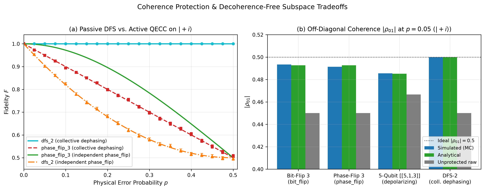
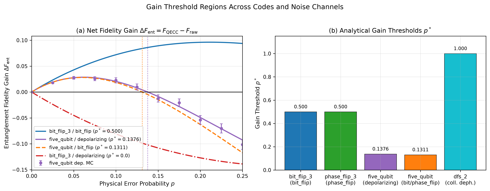
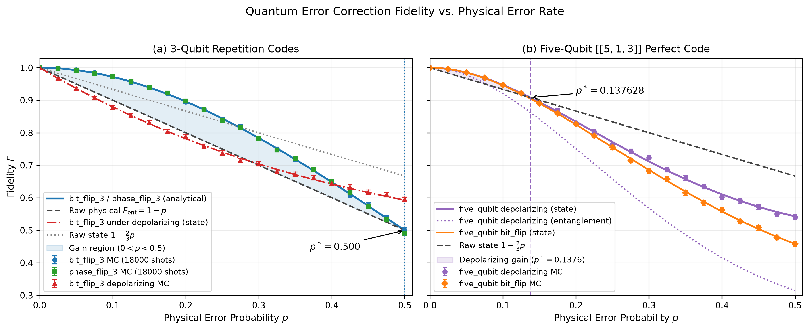

# Quantum Error Correction Codes (QECC)
## Theory, Stabilizer Circuits, Decoherence-Free Subspaces & GPU Simulation

**Graduate Seminar Presentation**  
*Simulation Suite: Python 3.12 + PyTorch CUDA 13.0 (RTX 5080 `sm_120`) + `eigenkit` v1.3.0*

---

## Slide 1 — Seminar Roadmap

1. **Why QECC is Fundamentally Different from Classical ECC** (no-cloning, $SU(2)$ continuum, projective collapse)
2. **Error Discretization & Knill–Laflamme Conditions** ($E_a^\dagger E_b$, $C_{ab}\delta_{ij}$)
3. **Stabilizer Codes & Quantum Hamming Bound** (`bit_flip_3`, `phase_flip_3`, `[[5,1,3]]` perfect code)
4. **Coherence ($\rho_{01}$) & Passive Decoherence-Free Subspaces (`dfs_2`)**
5. **Non-Destructive Ancilla Syndrome Extraction & Feed-Forward**
6. **Recent Experimental Milestones** (Google Willow, Harvard 48-logical, IBM 288-qubit qLDPC, Cat Qubits)
7. **Analytical Gain Thresholds, Metric Consistency & RTX 5080 Benchmarks**

---

## Slide 2 — Challenge 1: The No-Cloning Theorem

Classical repetition copies $b \mapsto (b, b, b)$. Quantum mechanics forbids copying unknown states.

**Wootters–Zurek Proof (Linearity & Unitarity):**
- Suppose unitary $U(|\psi\rangle|0\rangle) = |\psi\rangle|\psi\rangle$ and $U(|\phi\rangle|0\rangle) = |\phi\rangle|\phi\rangle$.
- Inner-product preservation ($U^\dagger U = I$) requires:
$$\langle \psi | \phi \rangle = \langle \psi | \phi \rangle^2 \implies \langle \psi | \phi \rangle \in \{0, 1\}.$$
- Arbitrary states cannot be cloned; instead we **entangle** information across a code subspace:
$$\alpha|0\rangle + \beta|1\rangle \;\longmapsto\; \alpha|0_L\rangle + \beta|1_L\rangle.$$

---

## Slide 3 — Challenge 2 & 3: Continuous Errors & Projective Collapse

- **Continuous $SU(2)$ Error Manifold:** Unlike discrete $\mathbb{F}_2^n$ bit flips, physical noise acts continuously on the Bloch sphere:
$$U(\theta, \hat{n}) = \exp\!\left(-i \frac{\theta}{2} \hat{n}\cdot\vec{\sigma}\right) = \cos\!\left(\frac{\theta}{2}\right) I - i \sin\!\left(\frac{\theta}{2}\right)(n_x X + n_y Y + n_z Z).$$
- **Projective Measurement Collapse:** Measuring physical qubits of $\alpha|000\rangle + \beta|111\rangle$ directly yields $|000\rangle$ (prob $|\alpha|^2$) or $|111\rangle$ (prob $|\beta|^2$), destroying off-diagonal coherence $\rho_{01} = \alpha\beta^*$.
- **Design Requirement:** Extract *only* error-syndrome parity while learning *zero* information about $\alpha$ and $\beta$.

---

## Slide 4 — Error Discretization via Pauli Expansion

Any single-qubit Kraus operator $E_k$ expands completely in the Pauli basis $\{I, X, Y, Z\}$:
$$E_k = c_{k,I} I + c_{k,X} X + c_{k,Y} Y + c_{k,Z} Z, \qquad c_{k,P} = \frac{1}{2}\operatorname{Tr}(P E_k).$$
- Acting on an encoded state creates a coherent superposition of Pauli-errored branches:
$$E_k^{(q)} |\psi_L\rangle = \sum_{P \in \{I, X, Y, Z\}} c_{k,P}\, P^{(q)} |\psi_L\rangle.$$
- **Projective Digitization:** Measuring stabilizer syndromes onto ancillas projects onto a single syndrome subspace $\Pi_s$, collapsing continuous noise into a discrete Pauli error $P_s^{(q)}$!

---

## Slide 5 — The Knill–Laflamme Conditions

**Theorem (Knill–Laflamme, 1997):** A code $\mathcal{C} = \operatorname{span}\{|i_L\rangle\}$ with projector $P_C$ corrects error set $\mathcal{E} = \{E_a\}$ iff:
$$\langle i_L | E_a^\dagger E_b | j_L \rangle = C_{ab}\delta_{ij} \qquad \Longleftrightarrow \qquad P_C E_a^\dagger E_b P_C = C_{ab} P_C,$$
where $C_{ab}$ is a Hermitian matrix independent of logical indices $i, j$.

- **Verified via `verify_knill_laflamme` (`tol = 1e-12`):**

| Code | Error Set $\mathcal{E}$ | $\vert\mathcal{E}\vert$ | Max Violation |
|---|---|---:|---:|
| `bit_flip_3` | `III, XII, IXI, IIX` | 4 | `0.000e+00` |
| `phase_flip_3` | `III, ZII, IZI, IIZ` | 4 | `0.000e+00` |
| `five_qubit` | All 16 weight $\le 1$ Paulis | 16 | `1.972e-31` |
| `dfs_2` | Collective `{II, ZZ}` | 2 | `0.000e+00` |

---

## Slide 6 — 3-Qubit Bit-Flip and Phase-Flip Codes

- **3-Qubit Bit-Flip Code (`bit_flip_3`):**
  - Encoding: $|0_L\rangle = |000\rangle$, $|1_L\rangle = |111\rangle$ via `CNOT(0->1), CNOT(0->2)`.
  - Stabilizers: `ZZI`, `IZZ`; logical operators $X_L = XXX$, $Z_L = ZII$.
  - Syndromes `00/10/11/01` $\to$ recovery `III / XII / IXI / IIX`.
- **3-Qubit Phase-Flip Code (`phase_flip_3`):**
  - Hadamard duality $H^{\otimes 3}$: $|0_L\rangle = |+++\rangle$, $|1_L\rangle = |---\rangle$.
  - Stabilizers: `XXI`, `IXX`; logical operators $X_L = ZZZ$, $Z_L = XII$.
  - Syndromes `00/10/11/01` $\to$ recovery `III / ZII / IZI / IIZ`.
- **Shared Analytical Polynomial (matched single-axis channel):**
$$F_e(p) = (1-p)^3 + 3p(1-p)^2 = 1 - 3p^2 + 2p^3 > 1 - p \quad \text{for } 0 < p < 0.5.$$

---

## Slide 7 — Quantum Hamming Bound & Synthesis to `[[5,1,3]]`

How small can a single-error-correcting ($t=1$) general Pauli code ($k=1$) be?

**Quantum Hamming Bound (Non-Degenerate):**
$$2^k \sum_{w=0}^{t} \binom{n}{w} 3^w \le 2^n.$$
- $n = 3$: $2(1 + 9) = 20 > 8$ (fails)
- $n = 4$: $2(1 + 12) = 26 > 16$ (fails)
- **$n = 5$:** $2(1 + 15) = 32 = 2^5$ (**exact saturation — the `[[5,1,3]]` perfect code!**)

All $2^4 = 16$ orthogonal 2D subspaces correspond bijectively to `IIIII` plus the 15 single-qubit `{X, Y, Z}` errors.

---

## Slide 8 — `[[5,1,3]]` Five-Qubit Code: Stabilizers & 1024-Term Enumerator

- **Cyclic Stabilizer Generators (`src/qecc/codes/five_qubit.py`):**
  - `S0 = XZZXI`, `S1 = IXZZX`, `S2 = XIXZZ`, `S3 = ZXIXZ`
- **Logical Operators (with `Z(0)` sign alignment in `encode_ops()`):**
  - $X_L = \texttt{XXXXX} = X^{\otimes 5}$, $Z_L = \texttt{ZZZZZ} = Z^{\otimes 5}$
- **16 Bijective 4-Bit Syndromes (`0000`–`1111`):**
  - `0000->IIIII`, `0001->XIIII`, `1010->ZIIII`, `1011->YIIII`, `1000->IXIII`, `0101->IZIII`, `1101->IYIII`, `1100->IIXII`, `0010->IIZII`, `1110->IIYII`, `0110->IIIXI`, `1001->IIIZI`, `1111->IIIYI`, `0011->IIIIX`, `0100->IIIIZ`, `0111->IIIIY`
- **1024-Term Weight Enumerator (`five_qubit_weight_enumerator()`):**
  - Logical-`I` coset weights $A^{(I)} = [1, 15, 0, 60, 135, 45]$ (sum = 256; $X, Y, Z$ cosets each `[0, 0, 30, 70, 90, 66]`).

---

## Slide 9 — Non-Destructive Ancilla Syndrome Extraction

To measure stabilizer $S_k$ without disturbing $\alpha|0_L\rangle + \beta|1_L\rangle$, we use **phase kickback** onto ancilla $a_k$:
$$|\psi_{\text{err}}\rangle|0\rangle_{a_k} \xrightarrow{H(a_k)} \xrightarrow{\Lambda(S_k)} \xrightarrow{H(a_k)} \frac{I + S_k}{2}|\psi_{\text{err}}\rangle|0\rangle_{a_k} + \frac{I - S_k}{2}|\psi_{\text{err}}\rangle|1\rangle_{a_k}.$$
- For any Pauli error $E$ with $S_k E = (-1)^{s_k} E S_k$, $E(\alpha|0_L\rangle + \beta|1_L\rangle)$ is an eigenstate of $S_k$:
  - Ancilla collapses to classical syndrome bit $s_k \in \{0, 1\}$ with **zero leakage** of $\alpha, \beta$.
- **Classical Conditional Feed-Forward:** Simulator slices the `(B, 2^{n_data}, 2^{n_ancilla})` state tensor on measured `syndrome`, renormalizes, applies `recovery_ops(syndrome)`, and runs `decode_ops()`.

---

## Slide 10 — Passive Decoherence-Free Subspaces (`dfs_2`)

Instead of active syndrome feedback, **DFS** hides logical qubits in a symmetry-protected subspace:
- **Encoding (`X(1), CNOT(0->1)`):** $\mathcal{H}_{\text{DFS}} = \operatorname{span}\{|01\rangle, |10\rangle\}$ (`n_data = 2, n_ancilla = 0`).
- **Collective Dephasing Invariance:**
$$(Z \otimes Z)|01\rangle = -|01\rangle, \qquad (Z \otimes Z)|10\rangle = -|10\rangle \implies (Z\otimes Z)|\psi_L\rangle = -|\psi_L\rangle,$$
$$(R_z(\phi) \otimes R_z(\phi))(\alpha|01\rangle + \beta|10\rangle) = \alpha|01\rangle + \beta|10\rangle \quad \forall\, \phi \in \mathbb{R}.$$
- Result: **$F = 1.0$ identically for all $p \in [0, 1]$** under `collective_dephasing`!
- **Symmetry-Breaking Tradeoff:** Under independent `phase_flip`, $F_e(p) = (1-p)^2 + p^2 = 1 - 2p + 2p^2 < 1 - p$ (for $p < 0.5$), whereas `phase_flip_3` achieves $1 - 3p^2 + 2p^3$ on independent flips and $1 - p$ on collective dephasing.

---

## Slide 11 — Off-Diagonal Coherence & DFS Tradeoffs (Empirical)

- At $p = 0.05$ on `|+i>` (`18,000` shots, `torch_cuda`), off-diagonal coherence $|\rho_{01}|$:
  - `bit_flip_3` (`bit_flip`): `0.493389` MC vs. `0.492750` analytical vs. `0.450000` raw
  - `phase_flip_3` (`phase_flip`): `0.491333` MC vs. `0.492750` analytical vs. `0.450000` raw
  - `five_qubit` (`depolarizing`): `0.485556` MC vs. `0.485112` analytical vs. `0.466667` raw
  - `dfs_2` (`collective_dephasing`): `0.500000` MC vs. `0.500000` analytical vs. `0.450000` raw

---

## Slide 12 — Recent Developments (1/2): Threshold Theorem, Willow & Neutral Atoms

- **Threshold Theorem & Surface Codes:** Below circuit threshold $p_{\text{th}}$, logical error decays exponentially $\epsilon_L \propto (p/p_{\text{th}})^{(d+1)/2}$.
- **Google Quantum AI Willow (Nature 2025):**
  - Rotated surface code scaling $d = 3 \to 5 \to 7$ on 105 qubits.
  - Below-threshold error suppression factor **$\Lambda = 2.14 \pm 0.02$** per distance step; **`0.143%`** logical error per cycle at $d = 7$ ($2.4\times$ beyond physical break-even).
- **Harvard / Lukin Neutral-Atom Processor (Bluvstein et al., Nature 2024):**
  - Coherent optical-tweezer shuttling enabling **`48` logical qubits** (280 physical atoms) with `[[8,3,2]]` codes and transversal logical gates.

---

## Slide 13 — Recent Developments (2/2): IBM qLDPC & Bosonic Cat Qubits

- **IBM Bivariate Bicycle qLDPC Codes (Bravyi et al., Nature 2024):**
  - Breaks 2D rate bounds with weight-6 non-local checks: the `[[144,12,12]]` gross code encodes 12 logical qubits at distance 12 using **`288` physical qubits** (`~0.7%` circuit threshold, $\sim 10\times$ qubit savings vs. surface code).
- **Hardware-Biased Bosonic Cat Qubits (Alice & Bob / Réglade et al. 2024; AWS / Putterman et al. 2025):**
  - Two-photon dissipation stabilizes $|\pm\alpha\rangle$, yielding **exponential bit-flip suppression** ($\propto e^{-2|\alpha|^2}$) so outer repetition/surface codes need only suppress phase flips.

---

## Slide 14 — Analytical Gain Thresholds & Metric Consistency

**Two distinct fidelity definitions must NEVER be mixed:**
- **Entanglement Fidelity ($F_e$):** $F_e(p) = P_I(p)$, compared against raw **$F_{e,\text{raw}}(p) = 1 - p$**.
- **Haar-Averaged State Fidelity ($F_{\text{state}}$):**
$$F_{\text{state}}(p) = 1 - \frac{2}{3}\bigl(1 - F_e(p)\bigr), \qquad F_{\text{state,raw}}(p) = 1 - \frac{2}{3}p.$$
- **Metric Separation Warning:** Comparing $F_{\text{state}}(p)$ against $1 - p$ creates a **spurious / false advantage mismatch**. Comparing $F_e$ vs. $1 - p$ or $F_{\text{state}}$ vs. $1 - \frac{2}{3}p$ preserves the **exact same gain threshold $p^*$**!

---

## Slide 15 — Exact `brentq` Gain Thresholds Across All Codes

| Code | Channel | Exact $p^*$ (`brentq`) | Gain Region |
|---|---|---:|---|
| `bit_flip_3` | `bit_flip` | `0.5` (`0.5000`) | $0 < p < 0.5$ |
| `phase_flip_3` | `phase_flip` | `0.5` (`0.5000`) | $0 < p < 0.5$ |
| `five_qubit` | `depolarizing` | `0.1376275643` (`0.1376`) | $0 < p < 0.1376$ |
| `five_qubit` | `bit_flip` / `phase_flip` | `0.1311231479` (`0.1311`) | $0 < p < 0.1311$ |
| `dfs_2` | `collective_dephasing` | `1.0` (`1.0000`) | $0 < p < 1.0$ |

---

## Slide 16 — Monte Carlo Sweeps (`18,000` Shots on RTX 5080 `torch_cuda`)

- `231` records across `21` $p$-points $\in [0, 0.5]$ (`seed = 20261118`):
  - At $p = 0.0$: $|F_{\text{sim}} - 1.0| \le 2.776 \times 10^{-15}$.
  - Across `180` $p > 0$ Monte Carlo points (`160` non-zero-variance points excluding the `20` exact $F=1.0$, `std_error=0.0` `dfs_2 / collective_dephasing` points): max `std_error = 0.003727`, max $|z| = 3.3430$, confirming analytical agreement.

---

## Slide 17 — Hybrid Backend Architecture & `eigenkit` Evaluation

- **`eigenkit` v1.3.0 Technical Check (`docs/eigenkit_evaluation.md`):**
  - Clean big-endian unitary statevector engine (`Circuit(..., provider="numpy").statevector(...)`).
  - **Confirmed QECC gaps:** lacks mid-circuit `measure`, classical `c_if` feed-forward, stochastic Pauli/Kraus noise (`sample()` raises `NotImplementedError`), `partial_trace`, and RTX 5080 `sm_120` PyTorch kernels (`CudaQuantumBackend` lacks `.statevector()`, 6 IR gates, and pins `pytorch-cu126`).
- **3 Swappable `QECCBackend` Implementations (`src/qecc/backends/`):**
  1. `numpy` (`NumPyCPUBackend`): `complex128` vectorized CPU reference.
  2. `torch_cuda` (`TorchCUDABackend`): native `torch==2.14.1+cu130` (`sm_120`) GPU engine.
  3. `eigenkit_unitary` (`EigenkitUnitaryAdapter`): unitary cross-verifier (`p=0` & deterministic errors; `stochastic_supported=false`).

---

## Slide 18 — RTX 5080 CUDA Benchmarks & Unitary Parity

- **Stochastic Parity (`numpy` vs. `torch_cuda`, `p=0.05`, `|+i>`):** `9/9 PASS`.
- **Unitary Parity (`eigenkit_unitary` vs. `numpy`/`torch_cuda`):** `6/6 PASS`, `Max |Δρ| <= 1.06e-15` overall (`<= 1.52e-17` `eigenkit_unitary` vs. `numpy`).

| Benchmark Case | Shots | CPU (`numpy`) | GPU (`torch_cuda` RTX 5080) | CUDA Speedup |
|---|---:|---:|---:|---:|
| `bit_flip_3 / bit_flip` | `100,000` | `0.179347 s` | `0.022497 s` | `7.97x` |
| `phase_flip_3 / phase_flip` | `100,000` | `0.334624 s` | `0.026219 s` | `12.76x` |
| `five_qubit / depolarizing` | `10,000` | `0.911476 s` | `0.064071 s` | `14.23x` |
| `five_qubit / depolarizing` | `100,000` | `10.080841 s` | `0.413090 s` | **`24.40x`** |

---

## Slide 19 — Conclusions & Reproducibility

- **Theory & Experiment Unified:** Exact Knill–Laflamme checks (`<= 1.972e-31`), 1024-term enumerator, `brentq` thresholds (`0.5`, `0.137628`, `0.131123`, `1.0`), 18k-shot sweeps, and `24.40x` RTX 5080 GPU acceleration agree cleanly.
- **Key Takeaway:** Always separate entanglement fidelity ($1 - p$) from Haar state fidelity ($1 - \frac{2}{3}p$) when evaluating QECC break-even thresholds.
- **Reproduce:**
  - `.venv/bin/python scripts/verify_analytical_thresholds.py`
  - `.venv/bin/python scripts/run_sweeps.py`
  - `.venv/bin/python scripts/run_benchmarks.py`
  - `.venv/bin/pytest tests/unit tests/e2e -v`
